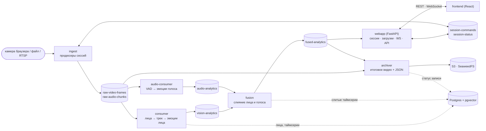

# Affectra — распознавание эмоций по лицу и голосу

Локальная система реального времени: находит лица в видео, следит за ними, узнаёт людей и определяет
эмоции **по лицу, по голосу и по их объединению**. Источник — камера и микрофон браузера, видеофайл
или IP-камера/поток. После каждой сессии сохраняется итоговое видео с разметкой и аналитика.

> НИР, 4 курс, 1 семестр. Всё работает локально: видео не покидает компьютер или локальную сеть,
> внешние API не используются.

**Что умеет**

- анализ живой камеры браузера, видеофайлов и RTSP/HTTP-потоков, несколько сессий одновременно;
- 6 эмоций CREMA-D: злость, отвращение, страх, радость, нейтрально, грусть;
- эмоции по лицу (Swin-T по окну кадров), по голосу (WavLM) и их слияние (8 методов);
- просмотр в браузере в реальном времени: рамки и подписи рисуются поверх видео;
- итоговая запись после сессии: mp4 с рамками и звуком + JSON-аналитика в S3-хранилище;
- узнавание людей между сессиями и поиск человека по фото, история эмоций, выгрузка в CSV.

---

## 1. Быстрый старт (Docker)

Нужны Docker Desktop (Compose v2) и около 8 ГБ свободной памяти.

1. Распакуйте модели CREMA-D (`crema_emotion_models.zip`) так, чтобы в `models/crema/` лежали
   `*.onnx`, `fusion_params.json` и `manifest.json`. Веса в git не хранятся.
2. При желании скопируйте `.env.example` в `.env` и поменяйте значения — у всех есть разумные значения
   по умолчанию.
3. Запустите стек:

   ```bash
   docker compose up -d --build
   ```

4. Откройте **http://localhost:8080**.

| Адрес | Что там |
|---|---|
| http://localhost:8080 | веб-интерфейс |
| http://localhost:8000/docs | REST API (Swagger) |
| http://localhost:7000 | Kafka UI |
| http://localhost:8333 | S3 API хранилища записей (SeaweedFS) |
| localhost:5433 | PostgreSQL + pgvector |

Модель детектора речи Silero VAD и веса FaceNet скачиваются при сборке образа. После запуска сервисы
загружают модели (до пары минут при первом старте). Пока в шапке горит «модели загружаются…», анализ не
запускается. В `docker ps` готовые сервисы отмечены `healthy`.

Kafka работает в режиме KRaft (без ZooKeeper). Чтобы поднять её из трёх узлов с репликацией топиков,
добавьте второй файл compose:

```bash
docker compose -f docker-compose.yml -f docker-compose.kafka-cluster.yml up -d --build
```

В кластере у топиков 3 реплики и `min.insync.replicas=2`: при остановке любого брокера сессии
продолжаются. Каждый брокер занимает около 350 МБ памяти. При переходе между режимами сначала выполните
`docker compose down`.

Второй узел приёма добавляет `docker-compose.multi-ingest.yml`: узлы делят сессии, а камера браузера работает
через любой из них (см. [docs/modules/ingest.md](docs/modules/ingest.md#несколько-узлов-приёма)).

Чтобы разнести систему по нескольким машинам, используйте `deploy/docker-stack.yml` (Docker Swarm). Роли узлов,
подготовка, NTP и запуск описаны в [docs/DEPLOYMENT.md](docs/DEPLOYMENT.md).

## 2. Как пользоваться

| Раздел | Что делать |
|---|---|
| **Анализ** | Выбрать источник (камера браузера, файл или ссылка на поток), отметить, что анализировать (лицо и голос, только лицо, только голос), нажать «Начать анализ». Откроется страница сессии: видео с рамками, кто в кадре и какая у него эмоция, что слышно в голосе. |
| **Записи** | Итоговые видео завершённых сессий: просмотр с перемоткой, распределение эмоций, скачивание mp4 и JSON. |
| **Люди** | Поиск человека по фото и его история эмоций за все сессии. |
| **Настройки** | Параметры по умолчанию для новых анализов: режим «Быстро/Точнее», частота анализа, узнавание людей, способ объединения лица и голоса. Модели, трекер и устройство — в блоке «Для специалистов». Внизу показано, сколько места занимают записи и загрузки и когда они удаляются. |

Камера браузера доступна только на `localhost` или по HTTPS — таково требование браузеров к `getUserMedia`.
Поэтому фронтенд слушает и **https://localhost:8443**. При первом старте он создаёт самоподписанный
сертификат. Как подключить камеру телефона или другого компьютера в сети:

1. Впишите адрес этого компьютера в `.env`: `TLS_HOSTS=192.168.1.10` (несколько — через запятую).
2. Если сертификат уже создан, удалите его (`docker volume rm facial-emotion-analyzer_frontend_certs`) и
   перезапустите `frontend`.
3. Откройте на устройстве `https://192.168.1.10:8443` и согласитесь с предупреждением браузера о сертификате.

Чтобы предупреждения не было, положите в том `frontend_certs` свои `affectra.crt` и `affectra.key`, например
от [mkcert](https://github.com/FiloSottile/mkcert).

**Автоочистка.** По умолчанию записи и загрузки хранятся, пока их не удалят вручную. С
`RECORDINGS_RETENTION_DAYS=30` и `UPLOADS_RETENTION_DAYS=7` в `.env` веб-сервер раз в час удаляет записи
старше 30 дней и загрузки старше 7 дней. Идущие сессии и файлы, которые сейчас обрабатываются, не трогаются.

---

## 3. Архитектура

Сервисы общаются через Kafka и не знают друг о друге; каждый можно перезапускать независимо и вынести на
отдельную машину. Веб-сервер медиа не читает: сессии запускает сервис приёма `ingest` по командам, а их
статусы возвращаются через compacted-топик, поэтому перезапуск веб-сервера сессии не прерывает.



| Сервис | Файл | Что делает |
|---|---|---|
| webapp | `webapp.py` | API: запуск сессий командами, загрузки в S3, отдача кадров и аналитики в браузер, история, записи |
| ingest | `ingest.py` | продюсеры сессий по командам: читает файл из S3, поток или камеру браузера (WebSocket) и пишет кадры и звук в Kafka; статусы сессий |
| consumer | `consumer.py` | YuNet раз в 2 кадра + трекер ByteTrack, идентификация FaceNet → pgvector, эмоции лица по окну 3 с (8 или 16 кадров) |
| audio-consumer | `audio_consumer.py` | окна 3 с с шагом 1 с; энергетический VAD → Silero VAD → WavLM только на речи |
| fusion | `fusion_consumer.py` | сопоставляет окно лица с окном голоса и сливает их выбранным методом |
| visualizer | `visualizer.py` | фоновая серверная разметка кадров (`annotated-video`) |
| archiver | `archiver.py` | копит кадры, звук и слитую аналитику сессии на диске, после конца собирает mp4 (H.264 + AAC) и JSON и кладёт в S3 |
| frontend | `frontend/` | React + Vite + Tailwind, раздаётся nginx |

В реальном времени браузер получает исходные кадры (`/api/live`) и аналитику (`/api/events`) и сам
рисует рамки, совмещая их по времени кадра. Итоговое видео с разметкой собирается уже после сессии.

Подробности по модулям — в [`docs/`](docs/ARCHITECTURE.md), развёртывание — в [docs/DEPLOYMENT.md](docs/DEPLOYMENT.md),
проект агента-аналитика сессий — в [docs/AGENT.md](docs/AGENT.md).

## 4. Модели и качество

Модели обучены на CREMA-D и проверены диктор-независимо. UAR — средняя по классам полнота,
среднее по 10 прогонам (5 фолдов × 2 сида), см. `models/crema/usage_rules.md`.

| Модальность | Модель | UAR |
|---|---|---:|
| лицо | Swin-T (кадры) + временная голова, окно 3 с | 0.689 |
| голос | WavLM-Base+, окно 3 с | 0.761 |
| лицо + голос | `stack_hidden` (стекинг по эмбеддингам) | 0.840 |

По умолчанию используются int8-версии моделей; fp32 включается режимом «Точнее» в настройках.
Детектор речи — [Silero VAD](https://github.com/snakers4/silero-vad) v5.1.2 (MIT).

## 5. Производительность

Ноутбук Intel Core i5-1135G7, только CPU, int8-модели.

**Видео** (источник 20 кадров/с, файл 1080p60): анализ успевает за источником без потерь — 20 кадров/с,
задержка от захвата до аналитики p50 37–113 мс. Детектор раз в 2 кадра с предсказанием трекера даёт
IoU рамок 0.93 и совпадение эмоций 98.7% с детекцией на каждом кадре.

**Голос**: Silero VAD отсекает окна без речи до модели эмоций. Ролик 40 с: 10 с речи, затем музыка,
шум и тишина:

| Детектор речи | Окон до модели голоса | CPU аудиосервиса |
|---|---:|---:|
| энергетический | 30 из 38 | 48% |
| Silero (по умолчанию) | 10 из 38 | 15% |

Silero стоит 15–20 мс на окно 3 с (около 3% времени WavLM). Вдобавок пропадают ложные «эмоции голоса»
на музыке и шуме.

## 6. Настройка

Главные переменные окружения (полный список — `.env.example`):

| Переменная | По умолчанию | Смысл |
|---|---|---|
| `EMOTION_MODEL_DEFAULT` | `crema-swin-int8` | модель лица для сессий без своих настроек |
| `VOICE_MODEL_DEFAULT` | `crema-wavlm-int8` | модель голоса |
| `FUSION_METHOD` | `stack_hidden` | метод слияния |
| `DETECTION_FREQUENCY` | `2` | детектор лиц раз в N кадров |
| `CLIP_FRAMES` | `8` | кадров на окно лица (8 или 16) |
| `VAD_BACKEND` | `silero` | `silero` или `energy` |
| `VAD_THRESHOLD` | `0.3` | доля речи в окне, начиная с которой работает модель голоса |
| `EMOTION_NUM_THREADS` / `VOICE_NUM_THREADS` | `2` / `2` | потоки ONNX Runtime |
| `ARCHIVE_MAX_DURATION_S` | `1800` | предел длительности итоговой записи |
| `S3_ACCESS_KEY` / `S3_SECRET_KEY` | `affectra` / `affectra-secret` | ключи хранилища записей |
| `KAFKA_BOOTSTRAP` | `kafka:29092` | брокеры Kafka для всех сервисов, если Kafka вынесена на другие машины |
| `KAFKA_EXTERNAL_HOST` | `localhost` | имя хоста, которое брокеры сообщают клиентам вне Docker |

Параметры отдельной сессии (модели, частота, слияние, узнавание людей) задаются в интерфейсе и
передаются сервисам через компактируемый топик `session-config`.

## 7. Разработка без Docker для Python-сервисов

```bash
docker compose up -d kafka topics-init postgres s3
```

```bash
python -m venv venv
```

```bash
venv/Scripts/pip install -r requirements.txt
```

Модель Silero VAD для локального запуска (без неё аудиосервис работает с энергетическим VAD):

```bash
curl -L -o models/vad/silero_vad.onnx --create-dirs https://github.com/snakers4/silero-vad/raw/v5.1.2/src/silero_vad/data/silero_vad.onnx
```

Затем в отдельных терминалах: `python ingest.py` (приём медиа, :8001), `python consumer.py`,
`python audio_consumer.py`, `python fusion_consumer.py`, `python visualizer.py`, `python archiver.py`,
`python webapp.py` (API на :8000). Сервисам, работающим с S3 (webapp, ingest, archiver), нужны
`S3_ENDPOINT=http://localhost:8333` и ключи из `.env`. Фронтенд:

```bash
npm --prefix frontend install
```

```bash
npm --prefix frontend run dev
```

Dev-сервер — http://localhost:5173, `/api` проксируется на :8000, `/api/capture` — на :8001.

**Тесты**

```bash
venv/Scripts/python -m pytest -q
```

```bash
npx --prefix frontend tsc --noEmit -p frontend
```

Тесты, которым нужны Kafka или PostgreSQL, пропускаются, если те не запущены.

## 8. API кратко

| Метод | Путь | Назначение |
|---|---|---|
| GET | `/api/health` | связь и готовность сервисов: какие модели ещё загружаются |
| GET | `/api/storage` | объём записей и загрузок, сроки автоочистки |
| GET | `/api/sessions` | активные и завершённые сессии |
| POST | `/api/sessions/camera` | сессия по адресу потока (RTSP/HTTP, номер камеры) |
| POST | `/api/sessions/browser` | сессия с камерой браузера; медиа идёт по WS `/api/capture/{id}` (сервис приёма) |
| DELETE | `/api/sessions/{id}` | остановить сессию |
| POST / GET | `/api/uploads` | загрузить файл в хранилище / список загруженных |
| POST | `/api/uploads/session` | запустить анализ загруженного файла |
| DELETE | `/api/uploads/{id}` | удалить файл (409, если он сейчас обрабатывается) |
| WS | `/api/live/{id}` | исходные кадры для отрисовки в браузере |
| WS | `/api/events/{id}` | аналитика в реальном времени |
| GET | `/api/recordings` | итоговые записи сессий и их статус |
| GET | `/api/recordings/{id}/video` | mp4 записи (поддерживает Range) |
| GET | `/api/recordings/{id}/analytics` | JSON-аналитика записи |
| POST | `/api/history/search` | поиск похожих лиц по фото |
| GET | `/api/history/users/{id}` | история эмоций человека |
| GET | `/api/history/sessions/{id}/export.csv` | выгрузка сессии в CSV |

Полная спецификация — на `/docs` после запуска.

## 9. Структура репозитория

```
ingest.py · consumer.py · audio_consumer.py · fusion_consumer.py · visualizer.py · archiver.py · webapp.py · producer.py
src/
  ingest/               сервис приёма: команды, продюсеры сессий, статусы, WebSocket браузера
  video_producing/      источники (файл, поток, вебкамера, камера браузера) и продюсер в Kafka
  frames_processing/    детекция, трекинг, идентификация, эмоции лица по окну кадров
  audio_processing/     окна звука, VAD (энергия + Silero), эмоции голоса
  fusion/               слияние лица и голоса, запись слитых таймсерий
  session_archive/      спул сессии, рендер mp4 + JSON, клиент S3
  session_config/       настройки сессий через топик session-config
  video_annotating/     отрисовка рамок и подписей
  emotion_kit/          инференс моделей CREMA-D (ONNX) и методы слияния
  db_managing/          схема БД и миграции
  web_server/           FastAPI: роуты и сервисы
  object_storage.py     клиент S3
frontend/               React-интерфейс
deploy/                 стек Docker Swarm и отправка образов в реестр
models/crema/           модели CREMA-D, параметры слияния, отчёт о качестве
scripts/                бенчмарк, проверки, утилиты
tests/                  pytest
docs/                   архитектура, развёртывание, описание модулей
```

## 10. Ограничения и этика

- Эмоция по лицу и голосу — **сигнал, а не истина**. Модели обучены на актёрских записях CREMA-D
  и могут ошибаться на спонтанной речи и мимике; не принимайте на их основе решений о людях.
- Узнавание людей хранит эмбеддинги и снимки лиц; используйте его только с согласия участников.
  Его можно выключить в настройках.
- Все данные (загрузки, записи, таймсерии, лица) хранятся локально: в PostgreSQL и в томе S3-хранилища.
  Загрузки удаляются на главной странице, записи — в разделе «Записи».
