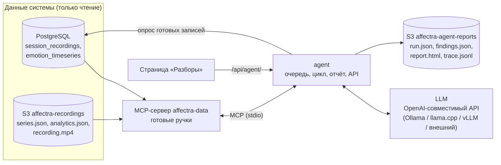
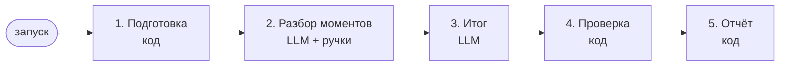

# Агент-аналитик сессий (проект)

> **Статус:** этапы 0–3 реализованы — данные, детекторы, MCP-сервер и отчёт без модели (раздел 11). Код этапа 4
> (цикл с LLM) написан и проверен тестами с поддельной моделью; прогон с настоящей моделью и сервис — впереди. Документ фиксирует решения, принятые при обсуждении; раздел 12 — открытые вопросы.
> Код: [emotion_moments.md](modules/emotion_moments.md), [affectra_mcp.md](modules/affectra_mcp.md),
> [agent.md](modules/agent.md).

Агент — отдельный сервис, который после сессии разбирает её данные и отмечает **моменты, требующие внимания**:
резкие смены эмоций, устойчивый гнев или грусть. Каждый момент он подаёт с таймингом, контекстом и объяснением,
чтобы исследователю не приходилось отсматривать длинные записи и много камер целиком.

---

## 1. Назначение и границы

| | |
|---|---|
| Пользователь | исследователь или оператор после сессии |
| Сценарий | одна камера — один человек: структурированное интервью (опрос пациента, собеседование); позже — фокус-группа |
| Что даёт | список моментов с интервалом, типом, уверенностью, объяснением и ссылкой на запись в нужную секунду |
| Роль системы | **первичный контур проверки**: отмечает, к чему присмотреться. Решение всегда принимает человек |
| Права агента | **только чтение** данных системы (БД и S3). Пишет только в свой бакет |

### Ограничения и этика

- **Что на самом деле измеряется.** Модели распознают *выраженную* эмоцию из 6 классов CREMA-D (гнев,
  отвращение, страх, радость, нейтральное, грусть) и обучены на постановочной актёрской речи. Это не то, что
  человек чувствует. Агент не ставит диагнозов и не судит о здоровье, лжи или характере человека.
  - Депрессии и усталости нет среди классов. Устойчивая грусть и бедная мимика — только поводы для внимания
    специалиста.
- **Неподходящие применения:**
  - определение лжи — у этого нет научного обоснования;
  - оценка кандидатов при приёме на работу — в ЕС распознавание эмоций на работе и в учёбе запрещено AI Act
    (ст. 5), кроме медицинских целей и безопасности.
- **Данные о здоровье.** В сценарии с пациентом даже обезличенные вероятности эмоций относятся к данным о
  здоровье. Их передачу во внешние API, особенно за рубеж, регулирует 152-ФЗ. Поэтому основной вариант —
  локальная модель, а внешний API допустим только с профилем приватности `external` (раздел 5).

---

## 2. Архитектура



**Ключевые решения:**

- **Детекторы находят, LLM объясняет.** Кандидатов находит детерминированный код. Модель оценивает каждого
  кандидата по контексту, выносит вердикт и пишет объяснение. Она может менять значимость момента, но в первой
  версии **не ищет новые моменты** сама.
- **Ручки вместо SQL.** Модель не пишет запросов. Она вызывает готовые инструменты MCP, внутри которых SQL и
  чтение S3 уже написаны.
- **Только чтение — на уровне прав, а не промпта:**
  - у MCP-сервера роль PostgreSQL только с `SELECT` на представления;
  - у него же ключ SeaweedFS только на чтение;
  - у агента ключ на запись только в свой бакет.
- **Модель где угодно.** Агент обращается к ней через OpenAI-совместимый API, поэтому сервер модели меняется
  настройкой.
- **Свой цикл.** Первая версия — собственный цикл поверх OpenAI API и официального MCP SDK. Если он себя
  оправдает, переход на LangGraph: фазы цикла станут узлами графа.

---

## 3. Данные

| Источник | Что берём | Зачем |
|---|---|---|
| `sessions/<id>/series.json` (S3, **новый**) | ряд с шагом 1 с: вероятности эмоций итоговые, лица и голоса, «есть речь», «лицо в кадре» | основной источник для ручек и детекторов |
| `sessions/<id>/analytics.json` (S3) | покадровая слитая аналитика: все треки, `face_scores`, `voice_scores` | сборка `series.json` для старых записей |
| `session_recordings` (БД) | список сессий, длительность, статус записи | обзор, запуск по готовности записи |
| `emotion_timeseries` (БД) | таймсерии узнанного человека по сессиям | история человека (версия 2) |
| `recording.mp4` (S3) | кадры | ключевые кадры для модели со зрением (версия 2) |

**Зачем `series.json`.** `analytics.json` хранит запись на каждый кадр: час при 20 кадрах/с — 72 тыс. записей,
десятки МБ. Эмоции обновляются раз в секунду, поэтому компактный ряд с шагом 1 с ничего не теряет. Его пишет
архиватор, а для старых записей его собирает скрипт.

**Один человек — несколько треков.** Если человек вышел из кадра и вернулся, у него новый трек. При сборке
ряда треки склеиваются в одного субъекта: по `face_id`, если человек узнан, иначе по присутствию в кадре.

---

## 4. Детекторы и профили сценариев

Детекторы — детерминированный код на ряде `series.json`. Пороги задаёт **профиль сценария** (YAML), каждая
находка хранит параметры, с которыми найдена.

| Тип | Правило |
|---|---|
| `abrupt_change` | расстояние Дженсена — Шеннона между распределениями соседних окон выше порога, уверенность в новом состоянии ≥ p, оно держится ≥ N окон |
| `sustained_anger`, `sustained_sadness` | доля эмоции ≥ p не меньше T секунд; гистерезис: вход при p, выход при p − δ |
| `face_voice_divergence` | во время речи ведущие эмоции лица и голоса расходятся долго и уверенно |
| `flat_affect` | изменчивость распределения эмоций за длинный период ниже порога («бедная мимика») |
| `baseline_deviation` | отклонение от обычного поведения узнанного человека в прошлых сессиях — **версия 2, только `local`** |

- **Слияние.** Пересекающиеся кандидаты сливаются в один момент с несколькими типами: резкая смена,
  переходящая в устойчивый гнев, — один эпизод.
- **Значимость** = длительность × интенсивность × уверенность. Формула простая, её можно объяснить.
- **Профиль `interview`** — первый профиль. Для опроса пациента в нём важнее устойчивая грусть и бедная
  мимика, для собеседования — резкие смены. Тексты для модели тоже берутся из профиля (раздел 6).

---

## 5. MCP-сервер `affectra-data`

**Сервер привязан к одному разбору.** При запуске он получает `session_id`, профиль приватности и профиль
сценария. Ручки работают только с этой сессией, поэтому модель не может запросить чужие данные. В первой
версии агент запускает сервер дочерним процессом (stdio) на каждый разбор, и ключи только на чтение получает
только этот процесс.

### Ручки

| Слой | Ручка | Что отдаёт |
|---|---|---|
| обзор | `get_session_overview()` | длительность, доля времени с лицом в кадре, доля речи, распределение эмоций по модальностям, флаги качества |
| обзор | `get_profile()` | пороги текущего профиля — чтобы модель могла объяснить правило |
| ряды | `get_emotion_series(from_s, to_s, modality, step_s)` | таблица вероятностей 6 эмоций; `modality` = `fused`, `face` или `voice`; не больше 120 точек — шаг растёт сам |
| ряды | `get_voice_windows(from_s, to_s)` | окна речи с вероятностью речи и эмоциями голоса |
| детекторы | `detect_moments()` | все кандидаты профиля по значимости: id, типы, интервал, метрики, параметры |
| детекторы | `find_sustained(emotion, min_prob, min_duration_s)` | уточнение со своими порогами |
| детекторы | `find_abrupt_changes(min_jsd, min_hold_s)` | уточнение со своими порогами |
| контекст | `get_moment_context(start_s, end_s, pad_s=15)` | «до / во время / после»: ведущие эмоции, речь, **качество** (доля кадров без лица, низкая уверенность детектора) |
| контекст | `get_person_history(n_sessions)` | обычное поведение человека — версия 2, только `local` |
| контекст | `get_keyframes(times)` | до 4 кадров записи — версия 2, только `local`, модель со зрением |

Качество в контексте особенно важно. Значительная часть ложных тревог — артефакты: лицо отвернулось, плохой
свет, трекер потерял человека.

### Формат ответов

- **Компактные таблицы:** ряды отдаются строками чисел с двумя знаками (`t,ANG,DIS,FEA,HAP,NEU,SAD`), а не
  JSON-объектами. Это примерно втрое меньше токенов.
- **Шапка:** у каждого ответа есть короткая шапка — что это, единицы, шаг.
- **Лимит точек:** не больше 120 точек за вызов; подробности модель получает, запрашивая интервал поуже.

### Профили приватности

| | `external` (внешний API) | `local` (локальная модель) |
|---|---|---|
| человек | `P1` | имя или id из базы, если узнан |
| время | секунды от начала сессии | плюс дата и время |
| название сессии и камеры | нет | есть |
| `get_person_history`, `get_keyframes` | **нет в списке ручек** | есть |

В `external` модель видит только вероятности эмоций. Ручки, которых нет в профиле, не отказывают, а
отсутствуют: модель не знает о них.

Обезличивание касается только того, что уходит в LLM. Отчёт собирает локальный код агента, и для ссылок и
кадров он обращается к MCP в профиле `local`.

---

## 6. Цикл агента

Модель не блуждает по ручкам свободно: ход определяет код, а модель работает внутри коротких ограниченных
шагов. Так поведение предсказуемо и на небольших локальных моделях.



1. **Подготовка (код).**
   - Открыть MCP-сессию, вызвать `get_session_overview` и `detect_moments`.
   - Слить пересекающиеся кандидаты.
   - Взять первые **K = 10** по значимости; остальные пойдут в отчёт таблицей.
   - Если кандидатов нет — сразу отчёт «моментов не найдено».
2. **Разбор каждого момента (LLM).** Отдельный короткий диалог на момент с чистым контекстом: системный
   промпт, обзор сессии, кандидат.
   - Модель может сделать **до 4 вызовов ручек**, затем обязана вызвать `submit_finding`.
   - `submit_finding` (строгая JSON-схема):

     | Поле | Значения |
     |---|---|
     | `verdict` | `attention` — стоит посмотреть, `likely_artifact` — вероятно артефакт, `not_significant` — незначимо |
     | `confidence` | `low`, `medium`, `high` |
     | `significance` | значимость по мнению модели; значимость детектора сохраняется рядом |
     | `summary` | суть в 1–2 фразах |
     | `explanation` | почему такой вердикт |
     | `evidence[]` | факт и ссылка на вызов ручки, из которого он взят |
     | `operator_check` | что посмотреть оператору |
3. **Итог по сессии (LLM, без ручек).** На вход — вердикты и обзор, на выход — заголовок объявления, абзац итога
   и порядок моментов.
4. **Проверка (код).**
   - Доказательства ссылаются на реальные вызовы.
   - Времена лежат внутри момента с допуском.
   - Значения полей допустимы.
   
   При ошибке модели один раз возвращается её текст на исправление. Не помогло — подставляется шаблонный текст
   по данным детектора с пометкой «без объяснения модели».
5. **Отчёт (код).** HTML, загрузка в бакет, `run.json`, объявление.

### Ограничения и отказоустойчивость

| Ситуация | Поведение |
|---|---|
| исчерпан бюджет ручек на момент | требование вызвать `submit_finding`; нет ответа — шаблонный вердикт |
| повтор одного и того же вызова | не исполняется, модели возвращается предупреждение |
| невалидный JSON | один повтор с текстом ошибки, затем шаблон |
| превышено время разбора (**15 мин**) | оставшиеся моменты без объяснений, статус «частично» |
| LLM недоступна | отчёт только по детекторам, статус «частично» |

Отчёт получается всегда: без модели он беднее, но не пропадает.

### Промпты

**Системный промпт на русском:**
- **Роль:** помощник исследователя, первичный контур проверки, решение за оператором.
- **Что значат числа:** вероятности *выраженной* эмоции из моделей, обученных на актёрской речи.
- **Правила:**
  - опираться только на результаты ручек;
  - сначала проверять артефакты: лицо пропадало, нет речи, низкое качество;
  - говорить осторожно;
  - не ставить диагнозов и не судить о лжи, здоровье и характере;
  - каждое утверждение подкреплять доказательством.
- **Формат ответа:** только через `submit_finding`.

**Добавка из профиля сценария** — на что смотреть в этом сценарии и чего не утверждать.

### Связь с моделью

- Ручки MCP автоматически переводятся в инструменты OpenAI API (`list_tools` → `tools`). Новая ручка не требует
  правок агента.
- Запасной режим для моделей, которые плохо вызывают инструменты: ответ JSON в тексте, агент его разбирает.
- Температура 0.2 и фиксированный seed, где сервер его поддерживает.

### Журнал

`trace.jsonl` каждого разбора хранит промпты, вызовы ручек с ответами и ответы модели. Он нужен для отладки,
для текста НИР — как агент пришёл к выводу — и для аудита в профиле `external`: видно, что именно ушло наружу.

---

## 7. Запуск разборов

- **Автоматически.** Агент раз в 30 с читает из `session_recordings` готовые записи без разбора и ставит их в
  очередь. Это только чтение, архиватор не меняется.
- **По запросу.** «Разобрать заново» с выбором профилей сценария и приватности. Новый разбор появляется
  отдельно, старые остаются.
- **Очередь.** Одна задача за раз, моменты по очереди: LLM на CPU медленная.
- **Статусы:** `queued` → `running` («момент 3 из 7») → `done` / `partial` / `error`.

---

## 8. Хранилище агента

Агент **не пишет в БД**. Всё его хранится в отдельном бакете `affectra-agent-reports`:

```
runs/<run_id>/run.json        сессия, профили, модель, статус, время, счётчики вердиктов
runs/<run_id>/findings.json   моменты: интервал, типы, метрики детектора, вердикт, тексты, доказательства
runs/<run_id>/report.html
runs/<run_id>/trace.jsonl
```

- **Удаление.** Если запись сессии удалена (вручную или автоочисткой), агент удаляет её разборы сам: при опросе
  он видит, что записи больше нет.
- **Поиск по всем находкам** («все эпизоды грусти за месяц») в первой версии делается перебором файлов. Если
  понадобится, позже добавится таблица.

---

## 9. Отчёт и страница «Разборы»

### Объявление

Лента карточек на странице «Разборы», новые сверху:
- статус, сессия, дата, длительность, профиль;
- заголовок от модели («2 момента стоит посмотреть: …»);
- счётчики вердиктов и ссылки ▶ на главные моменты — открывают запись на нужной секунде (`?t=`);
- кнопки «Открыть отчёт», `findings.json`, «Разобрать заново»;
- строка «модель … · локально · решение за оператором».

Фильтры: только с «стоит посмотреть», по дате, по сессии. Вердикты различаются формой значка и подписью, а не
только цветом.

### Отчёт (HTML)

Самодостаточный файл: стили и графики встроены, внешних скриптов нет. Он открывается без интернета.

1. **Шапка:** сессия, дата, длительность, сценарий, модель, профиль приватности, id разбора, оговорка о
   первичном контуре.
2. **Итог:** абзац модели, счётчики вердиктов, качество данных («лицо в кадре 94% времени, речь 61%»).
3. **Таймлайн:**
   - вероятности 6 эмоций во времени;
   - пронумерованные полосы моментов, окрашенные по вердикту;
   - дорожки «лицо в кадре» и «речь».
4. **Карточки моментов** в порядке вердикт → значимость:
   - интервал, типы, вердикт и уверенность;
   - обе значимости — детектора и модели;
   - суть, объяснение, доказательства, «что проверить»;
   - мини-график интервала ±15 с;
   - ссылка на запись.
5. **Остальные кандидаты** — таблица.
6. **Методика:** пороги профиля, определения детекторов, версии моделей распознавания и LLM.
7. **Ссылки** на `findings.json` и `trace.jsonl`.

**Как строится.** Графики — SVG из matplotlib на сервере, HTML — шаблон Jinja2. Модель пишет только тексты.
Сборка отчёта — детерминированная функция `build_report(run)`, модели как ручка не выдаётся.

**PDF** — после готовой базы (этап 6): WeasyPrint из того же HTML.

---

## 10. Интеграция с системой

| Что | Как |
|---|---|
| сервис | `agent` (FastAPI): очередь, опрос записей, API, удаление осиротевших разборов, сигнал в `service-health` |
| API | `GET /runs`, `GET /runs/{id}`, `GET /runs/{id}/report.html`, `POST /runs` |
| nginx | `/api/agent/` → `agent`, по образцу `/api/capture/` → `ingest` |
| compose | сервисы `agent` и `ollama`; Ollama в отдельном профиле compose, обычный запуск её не поднимает |
| права | роль PostgreSQL `affectra_reader` с доступом к представлениям; в SeaweedFS ключ на чтение записей и ключ на запись в бакет агента |
| интерфейс | страница «Разборы»; страница записи понимает `?t=секунды` |
| доступ | в первой версии без ограничений, как и остальная система |

### Настройки (`agent.yaml`)

| Параметр | Начальное значение |
|---|---|
| адрес LLM, модель | не выбраны |
| температура | 0.2 |
| профиль приватности | `local` |
| профиль сценария | `interview` |
| моментов на разбор (K) | 10 |
| вызовов ручек на момент | 4 |
| время на разбор | 15 мин |
| опрос готовых записей | 30 с |

---

## 11. План реализации

Каждый этап можно проверить отдельно. **Этапам 0–3 модель не нужна.** Этапы 0–3 готовы (✅).

```
0 ─► 1 ─► 2 ─┐
     └─► 3 ──┴─► 4 ─► 5 ─► 6
```

| Этап | Что | Проверка |
|---|---|---|
| **0. Данные** ✅ | `series.json` в архиваторе и скрипт для старых записей; склейка треков в субъекта; `?t=` на странице записи; роль `affectra_reader` и ключи SeaweedFS | тесты сборки ряда; сверка с `analytics.json`; запись с ключом на чтение отклоняется |
| **1. Детекторы** ✅ | пять детекторов, слияние кандидатов, значимость, профиль `interview`, команда `detect <session_id>` | тесты на синтетических рядах с вшитыми эпизодами; прогон на реальных записях. Это базовая линия «только детекторы» |
| **2. MCP-сервер** ✅ | ручки на официальном Python MCP SDK, привязка к разбору, компактный формат, профили приватности | тесты ручек; MCP Inspector; в `external` нет имён и ручек `local` |
| **3. Отчёт без LLM** ✅ | `build_report`: шаблон, SVG-графики, карточки с данными детектора, методика | отчёты по реальным записям, проверка глазами |
| **4. Цикл агента** (код ✅, прогон с моделью — впереди) | клиент LLM, перевод ручек в инструменты, фазы 2–4, `submit_finding`, бюджеты, запасной режим, `trace.jsonl`, `agent.yaml` | тесты с поддельной моделью: верный ответ, мусор, зацикливание, молчание; прогон с локальной моделью через Ollama. **Нужен выбор модели** |
| **5. Сервис** | сервис `agent`, очередь, опрос, API, удаление осиротевших разборов, compose, nginx, страница «Разборы» | полный путь: сессия → разбор появился сам → отчёт открывается → после удаления записи разбор исчезает |
| **6. Развитие** | PDF; кадры для модели со зрением; история человека (`baseline_deviation`); LangGraph; оценка «детекторы» против «детекторы + LLM» на размеченных сессиях | — |

### Где будет код

```
src/session_archive/series.py   сборка series.json (этап 0)
src/emotion_moments/            детекторы, профили, слияние кандидатов (этап 1) — без зависимостей от MCP и LLM
src/affectra_mcp/               MCP-сервер: ручки, профили приватности (этап 2)
src/agent/                      цикл, клиент LLM, отчёт, сервис, API (этапы 3–5)
mcp_server.py, agent.py         точки входа
agent.yaml
profiles/interview.yaml
```

---

## 12. Открытые вопросы

- **Модель — выбрана.** Семейство Qwen (Apache 2.0) через Ollama, без режима «размышлений»:
  - основной вариант — 8–9B на ПК с RTX 4070 (12 ГБ), агент обращается к нему по локальной сети;
  - для разработки и запаса — 4B на ноутбуке;
  - для сравнения — 14B или MoE 30B-A3B.

  Точные имена моделей выбираются при загрузке. Исходные требования к модели:
  - надёжный вызов инструментов (на практике от 7–8 млрд параметров, лучше 14);
  - контекст от 16–32 тыс. токенов;
  - для версии 2 — зрение.
- **Оценка агента.** Нужна разметка моментов: синтетические сессии из склеенных клипов CREMA-D с известными
  сменами эмоций и/или ручная разметка реальных сессий. Метрики:
  - точность и полнота найденных моментов, временное пересечение интервалов;
  - доля утверждений отчёта, подтверждённых данными;
  - сравнение «детекторы» против «детекторы + LLM».
- **Числа в профиле `interview`.** Конкретные пороги подбираются на этапе 1 по реальным записям.
- **Другие сценарии** (фокус-группа: несколько человек, метки стимулов) и дополнительные типы моментов —
  после первой версии.
- **Доступ к отчётам** и разделение пользователей — после первой версии.
