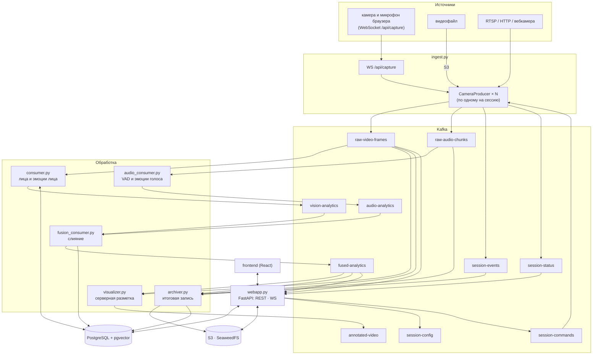
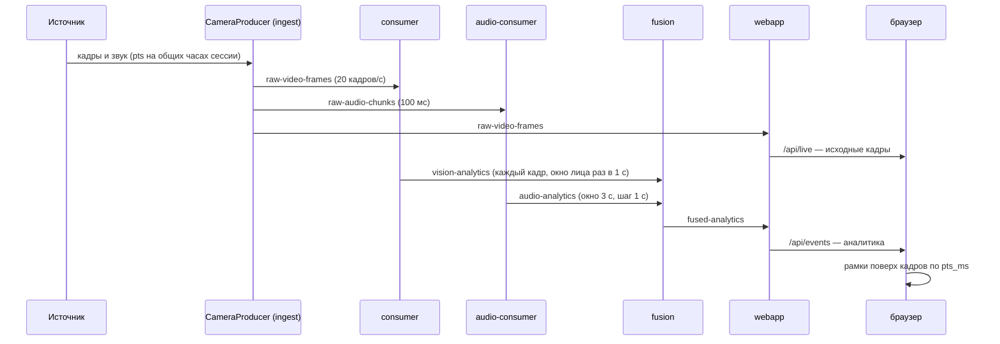
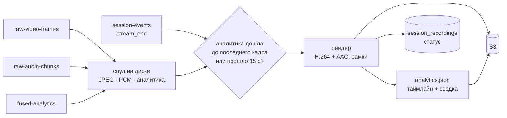
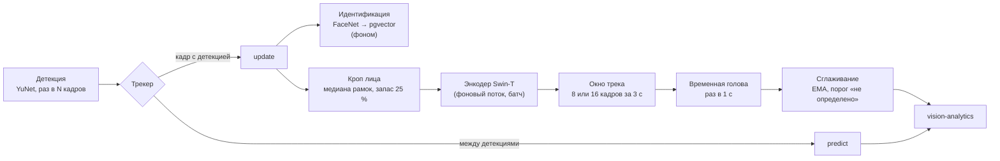
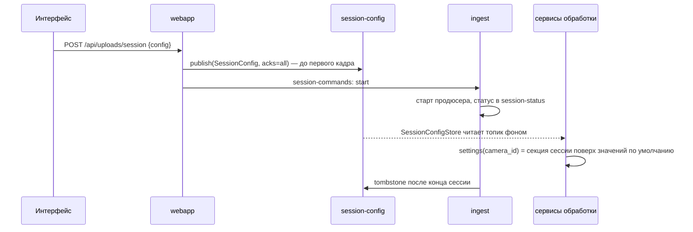

# Архитектура Affectra

Документ описывает устройство системы по слоям и объясняет принятые проектные решения. Диаграммы —
Mermaid, рендерятся на GitHub. Карта кода и форматы сообщений — в [`CODE_OVERVIEW.md`](CODE_OVERVIEW.md),
подробности по модулям — в [`modules/`](modules/README.md).

---

## 1. Слои системы

Affectra — восемь процессов, которые обмениваются сообщениями через Apache Kafka, плюс два хранилища:
PostgreSQL с pgvector (лица, таймсерии, статусы записей) и S3-совместимое хранилище SeaweedFS (загрузки и
итоговые записи сессий). Ни один сервис не держит у себя в памяти или на диске состояние, которое нужно
другим, поэтому сервисы можно разнести по разным машинам.

Декомпозиция на процессы даёт три свойства:

1. **Изоляция отказов.** Падение аннотатора или архиватора не останавливает анализ; падение аудиосервиса
   превращает слияние в «только лицо», но видео продолжает обрабатываться.
2. **Независимое масштабирование.** Тяжёлые стадии (видео и голос) — отдельные процессы со своими
   потоками ONNX Runtime; фоновые сервисы работают с пониженным приоритетом.
3. **Замена алгоритмов без остановки.** Каждый сервис видит только свои входные топики; модели, трекер
   и метод слияния выбираются на уровне сессии.

### Топики Kafka

| Топик | Пишет | Читают | Содержимое |
|---|---|---|---|
| `raw-video-frames` | продюсер сессии | consumer, visualizer, archiver, webapp (`/api/live`) | msgpack: кадр JPEG, `pts_ms`, время захвата |
| `raw-audio-chunks` | продюсер сессии | audio-consumer, archiver | msgpack: PCM s16le 16 кГц, чанки по 100 мс |
| `session-events` | продюсер сессии | все сервисы обработки, archiver | msgpack: `stream_start` / `stream_end` |
| `session-config` | webapp | consumer, audio-consumer, fusion | msgpack: настройки сессии, топик с уплотнением (compaction) |
| `session-commands` | webapp | ingest | msgpack: `start` с описанием сессии, `stop` |
| `service-health` | все сервисы, кроме webapp | webapp | msgpack: сигнал экземпляра сервиса раз в 5 с (`starting` / `ready`), compacted |
| `session-status` | ingest | webapp, ingest (владелец сессии браузера) | msgpack: состояние и статистика сессии, compacted, раз в секунду |
| `vision-analytics` | consumer | fusion | JSON: лица кадра, эмоция лица, окно эмоций |
| `audio-analytics` | audio-consumer | fusion | JSON: окно голоса, речь или нет, эмоция |
| `fused-analytics` | fusion | webapp (`/api/events`), visualizer, archiver | JSON: лица кадра с итоговой эмоцией |
| `annotated-video` | visualizer | webapp (MJPEG) | msgpack: размеченный кадр JPEG |

Во всех топиках ключ — `camera_id`, и число партиций одинаковое. Поэтому видео, звук, события и аналитика
одной сессии попадают в партиции с одним номером, и порядок внутри сессии сохраняется.

Kafka работает в режиме KRaft: брокер и контроллер метаданных в одном процессе, ZooKeeper не нужен. На одной
машине это один узел с репликацией 1. `docker-compose.kafka-cluster.yml` добавляет ещё два узла: кворум
контроллеров из трёх, у топиков 3 реплики и `min.insync.replicas=2`. Конфиги, команды и события сессий
пишутся с `acks=all` и идемпотентностью, поэтому они переживают падение любого узла. Медиа пишутся с
`acks=1`: для живого анализа свежесть кадра важнее гарантии доставки. Проверено остановкой брокера-лидера:
лидерство перешло на другой узел, запись и чтение статусов не прервались, вернувшийся брокер догнал реплики.

---

## 2. Путь в реальном времени

Задача — показать эмоции с задержкой в доли секунды, не копя очередь.

- **Общее время.** У каждого кадра и аудиочанка есть `pts_ms` — время от начала сессии на одних часах.
  По нему окно лица сопоставляется с окном голоса, а браузер совмещает рамки с кадрами.
- **Свежесть важнее полноты.** Сервисы отбрасывают сообщения старше порога (`MAX_FRAME_AGE_MS = 1000`
  для видео, 2000 для звука и слияния). Продюсер при переполнении очереди теряет кадры, но не звук.
- **Рисует браузер.** Браузер получает исходные кадры и аналитику по двум WebSocket, задерживает показ на
  величину задержки аналитики и интерполирует рамки по времени. Серверная разметка (`visualizer`)
  остаётся фоновой и в путь реального времени не входит.

## 3. Путь после сессии

После `stream_end` архиватор собирает итоговую запись: в ней все модальности уже слиты.

Во время сессии архиватор ничего не перекодирует, а только складывает данные на диск, чтобы не отнимать
CPU у анализа. Рендер идёт в одном фоновом потоке с пониженным приоритетом. Статусы записи:
`recording` → `rendering` → `ready` или `failed`.

---

## 4. Видео: стадии обработки кадра

1. **Детекция** — YuNet (`cv2.FaceDetectorYN`): на его рамках обучалась модель эмоций. Кадр уменьшается
   до 480 пикселей по длинной стороне. Детектор работает раз в `DETECTION_FREQUENCY = 2` кадра, между
   детекциями трекер предсказывает рамки.
2. **Трекинг** — ByteTrack (по умолчанию) или DeepSORT за общим интерфейсом. При детекции раз в N кадров
   частота и порог подтверждения ByteTrack делятся на N: иначе треки теряются.
3. **Идентификация** — эмбеддинг FaceNet ищется в pgvector в отдельном потоке. Пока ответа нет, трек
   носит временный `pending-…`-идентификатор.
4. **Эмоции лица** считаются по окну, а не по кадру. Признаки кропов (Swin-T, 768 чисел) копятся по треку
   на шкале времени. Раз в `EMOTION_HOP_MS = 1000` временная голова оценивает окно из 8 или 16 кадров
   за последние 3 с. Кодирование кропов вынесено в фоновый поток: если оно не успевает, кропы
   пропускаются, а кадры не задерживаются.
5. **Сглаживание** — EMA по окнам; при максимальной вероятности ниже 0.4 эмоция «не определена».

Конвейер `consumer.py` — три стадии в разных потоках: A — чтение Kafka и декодирование JPEG, B — обработка
кадра, C — отправка результата. Очереди между стадиями короткие (4 элемента), чтобы задержка не копилась.

## 5. Голос

Звук режется на окна 3 с с шагом 1 с. Окно проходит два фильтра:

1. **Энергетический VAD** — доля кадров по 20 мс громче −45 dBFS. Тишина отсекается почти бесплатно.
2. **Silero VAD** — доля кадров по 32 мс с речью. Отсекает музыку, шум и тоны.

Если доля речи не меньше `VAD_THRESHOLD = 0.3`, окно уходит в WavLM-Base+. Окно без речи всё равно
публикуется с `is_speech = false`: слиянию нужно знать, что голоса нет. Результаты сглаживаются с
гистерезисом смены метки.

## 6. Слияние модальностей

Сервис слияния держит по каждой камере последние окна голоса и по каждому треку — последнее окно лица.

- Когда у трека появляется новое окно лица, к нему подбирается окно голоса с наибольшим перекрытием
  по времени (не меньше `min_overlap_ms = 1000`). Пара сливается методом сессии.
- Если окна лица ещё нет, используется последнее окно с речью не старше `voice_max_age_ms` — получается
  «только голос».
- Голос приписывается лицу, только если в кадре одно лицо. Если окно лица уже слито с голосом, мелькнувшее
  второе лицо этот голос не снимает (защита от мерцания).

Методы слияния — из `emotion_kit`: обученные (`stack_hidden`, `stack_logits`, `weighted_logits[_robust]`)
и без обучения (`confidence_weighted`, `mean_probs`, `audio_only`, `video_only`). Без файла параметров
обученные методы заменяются на `mean_probs`. В результате кадра поле `fusion_used` показывает, что
реально слито, например `stack_hidden -> video_only (нет аудио)`.

---

## 7. Настройки по сессиям

Каждая сессия может иметь свои модели, частоту, трекер и метод слияния. Настройки не передаются в каждом
кадре, а живут в отдельном топике:

- Конфиг разделён на секции `vision`, `audio`, `fusion`: каждый сервис читает только свою.
- Ревизия растёт с каждым изменением, старая ревизия никогда не перетирает новую.
- Сервис кэширует ресурсы по ключу настроек: модель с теми же параметрами переиспользуется между сессиями,
  смена трекера пересоздаёт только трекер камеры.
- Если на первом кадре конфиг ещё не прочитан, видеосервис ненадолго ждёт его, затем работает на значениях
  по умолчанию.

## 8. Хранилища

**PostgreSQL + pgvector**

| Таблица | Что хранит | Кто пишет |
|---|---|---|
| `face_embeddings` | эмбеддинг FaceNet (vector 512), снимок лица, время первого появления | consumer |
| `emotion_timeseries` | таймсерия эмоций трека человека; `modality` = `face` или `fused` | consumer, fusion |
| `session_audio_timeseries` | окна голоса сессии без привязки к человеку | fusion |
| `session_recordings` | статус итоговой записи, ключи в S3, сводка | webapp (имя), archiver (статус) |

Схема приводится к текущей версии идемпотентными миграциями при подключении любого сервиса
(`src/db_managing/schema.py`).

**S3 (SeaweedFS)** — бакет `affectra-recordings`: загрузки `uploads/<id>.<ext>` с метаданными (исходное имя,
дорожки, длительность) и записи `sessions/<id>/recording.mp4`, `sessions/<id>/analytics.json`. Загрузки лежат в
хранилище, а не на диске веб-сервера, чтобы узел приёма мог работать на другой машине. Веб-сервер отдаёт видео потоком с поддержкой Range, поэтому в браузере
работает перемотка. Образы MinIO в 2025 году перестали публиковаться, поэтому выбран SeaweedFS
(Apache 2.0); код работает с любым S3-совместимым хранилищем через boto3.

## 9. Веб-интерфейс

React + TypeScript + Vite + Tailwind, в Docker раздаётся nginx, который проксирует `/api` и WebSocket на
webapp. Разделы:

- **Анализ** — запуск в три шага: источник, что анализировать, название. Ниже — идущие и завершённые сессии.
- **Сессия** — видео с рамками, кто в кадре и что чувствует, голос; статистика и технические подробности
  свёрнуты.
- **Записи** — итоговые видео, распределения эмоций, скачивание.
- **Люди** — поиск по фото и история человека.
- **Настройки** — значения по умолчанию для новых анализов (хранятся в браузере).

Камера браузера — модуль `capture/browserCapture.ts` вне React-дерева, поэтому захват не прерывается при
переходах между страницами. Кадры уменьшаются до 640×480 и кодируются в JPEG на canvas, звук приводится
к 16 кГц моно в AudioWorklet.

---

## 10. Проектные решения и компромиссы

| Решение | Почему | Цена |
|---|---|---|
| Kafka между стадиями | изоляция отказов, повтор и подключение новых потребителей без изменений продюсера | лишний сервис в развёртывании, сериализация |
| Эмоции лица по окну 3 с, а не по кадру | так обучена модель CREMA-D; окно устойчивее к морганиям и ракурсу | оценка обновляется раз в секунду, первая — через 3 с |
| Детектор раз в 2 кадра | детектор — самая дорогая часть кадра; IoU рамок 0.93, совпадение эмоций 98.7 % | рамки между детекциями — прогноз трекера |
| Рамки рисует браузер | живой показ с частотой источника без перекодирования на сервере | браузер совмещает кадры и аналитику сам |
| Слияние — отдельный сервис | голос и видео приходят с разной задержкой; слияние не тормозит ни одну модальность | ещё один сервис и топик |
| Итоговая запись после сессии | сессия анализируется в реальном времени, а итог — с полной слитой аналитикой и звуком | запись готова через несколько секунд после конца |
| Энергетический VAD + Silero | модель голоса не тратит CPU на тишину, музыку и шум (на смешанном ролике 48 % → 15 % CPU) | 15–20 мс на окно |
| int8 по умолчанию | вдвое быстрее на CPU, точность почти не меняется | fp32 доступен как режим «Точнее» |
| Конфиг сессии в compacted-топике | сервисы узнают настройки без запросов к webapp и после перезапуска | конфиг надо публиковать до первого кадра |
| Kafka в режиме KRaft, кластер — отдельным файлом | без ZooKeeper на один процесс меньше; на одной машине один брокер, для отказоустойчивости три | при смене режима топики пересоздаются |
| Запуск анализа после загрузки моделей | первая сессия после старта не теряет голос или лицо; состояние сервисов видно в интерфейсе | сигнал каждого сервиса раз в 5 с, проверка перед стартом сессии |
| Продюсеры в отдельном сервисе приёма | веб-сервер не читает медиа; приём можно держать рядом с камерами, сессии переживают перезапуск веб-сервера | команды и статусы через Kafka, старт сессии ждёт ответа узла |

## 11. Дальнейшее развитие

- оценка точности всей системы на тестовой части CREMA-D и сравнение с офлайн-метриками моделей;
- бенчмарк в Docker: кадры в секунду и задержка в зависимости от частоты детекции, режима и числа сессий;
- агент-аналитик сессий: моменты, требующие внимания, с объяснением локальной LLM — проект в [AGENT.md](AGENT.md);
- метрики сервисов (Prometheus, Grafana);
- отказоустойчивое хранение: репликация PostgreSQL и SeaweedFS с несколькими volume-серверами (развёртывание на
  нескольких машинах — [DEPLOYMENT.md](DEPLOYMENT.md));
- Kubernetes-манифесты по образцу стека Swarm.
