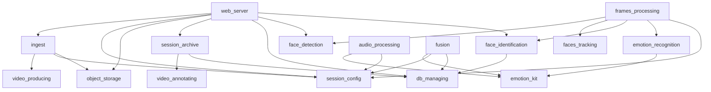

# Документация по модулям

Каждый файл описывает один модуль: назначение, состав, публичный API, поток данных и неочевидные места.
Общая карта кода — [`CODE_OVERVIEW.md`](../CODE_OVERVIEW.md), архитектура — [`ARCHITECTURE.md`](../ARCHITECTURE.md),
развёртывание — [`DEPLOYMENT.md`](../DEPLOYMENT.md), проект агента-аналитика — [`AGENT.md`](../AGENT.md).

| Документ | Модуль | Роль |
|---|---|---|
| [entrypoints.md](entrypoints.md) | `*.py` в корне | Точки входа восьми скриптов запуска и переменные окружения |
| [ingest.md](ingest.md) | `src/ingest/` | Сервис приёма: продюсеры сессий по командам, статусы, камера браузера |
| [video_producing.md](video_producing.md) | `src/video_producing/` | Источники медиа (файл, поток, вебкамера, браузер) и продюсер в Kafka |
| [frames_processing.md](frames_processing.md) | `src/frames_processing/` | Видеопайплайн: стадии A/B/C, настройки сессий, метрики |
| [face_detection.md](face_detection.md) | `…/processing/face_detection/` | Детекторы YuNet и MediaPipe, фильтры |
| [faces_tracking.md](faces_tracking.md) | `…/processing/faces_tracking/` | ByteTrack и DeepSORT, прогноз между детекциями |
| [face_identification.md](face_identification.md) | `…/processing/face_identification/` | FaceNet и поиск в pgvector |
| [emotion_recognition.md](emotion_recognition.md) | `…/processing/emotion_recognition/` | Эмоции лица по окну кадров, окна треков, сглаживание |
| [audio_processing.md](audio_processing.md) | `src/audio_processing/` | Окна звука, VAD (энергия и Silero), эмоции голоса |
| [fusion.md](fusion.md) | `src/fusion/` | Слияние лица и голоса, запись слитых таймсерий |
| [session_config.md](session_config.md) | `src/session_config/` | Настройки сессий в топике `session-config` |
| [emotion_moments.md](emotion_moments.md) | `src/emotion_moments/` | Агент: секундный ряд, детекторы моментов, профили сценариев |
| [affectra_mcp.md](affectra_mcp.md) | `src/affectra_mcp/`, `mcp_server.py` | Агент: MCP-сервер с ручками только на чтение |
| [agent.md](agent.md) | `src/agent/` | Агент: подготовка разбора, вердикты, HTML-отчёт |
| [service_health.md](service_health.md) | `src/service_health/` | Сигналы живости сервисов и запуск анализа только после загрузки моделей |
| [session_archive.md](session_archive.md) | `src/session_archive/` | Итоговая запись сессии: спул, рендер, S3 |
| [emotion_kit.md](emotion_kit.md) | `src/emotion_kit/` | Инференс моделей CREMA-D и методы слияния |
| [video_annotating.md](video_annotating.md) | `src/video_annotating/` | Отрисовка рамок, серверная разметка кадров |
| [db_managing.md](db_managing.md) | `src/db_managing/` | Схема БД, миграции, обёртки psycopg2 |
| [web_server.md](web_server.md) | `src/web_server/` | FastAPI: сессии, загрузки, WebSocket, записи, история |
| [frontend.md](frontend.md) | `frontend/` | React-интерфейс, камера браузера, отрисовка рамок |
| [common.md](common.md) | `emotion_labels.py`, `cpu_threads.py`, `logging_config.py`, `object_storage.py`, `data_models/` | Общие мелкие модули |
| [scripts.md](scripts.md) | `scripts/` | Бенчмарк, проверки потоков и БД, утилиты |

## Зависимости между модулями

Обратных зависимостей нет: сервисы обработки не знают о веб-сервере, `session_config` и `db_managing`
не знают о пайплайнах, `video_producing` не знает о `ingest`, который его запускает. Веб-сервер использует
из `ingest` только контракты команд и статусов. Общий для
сервисов Kafka-ввод (`frames_processing/kafka_io.py`) используют также аудиопайплайн и слияние.
