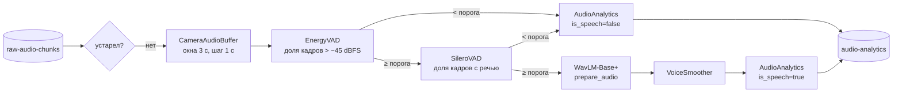

# `audio_processing` — эмоции по голосу

Сервис `audio_consumer.py`: из чанков `raw-audio-chunks` собирает окна, отсекает окна без речи и
оценивает эмоцию голоса моделью WavLM. Результаты идут в `audio-analytics`.

```
src/audio_processing/
├── pipeline.py    AudioPipeline: сессии, окна, VAD, модель, публикация
├── buffer.py      CameraAudioBuffer, AudioWindow: склейка чанков и окна с перекрытием
├── vad.py         EnergyVAD, SileroVAD
├── recognizer.py  VoiceEmotionRecognizer: CREMA WavLM, произвольная ONNX, заглушка
├── smoothing.py   VoiceSmoother: EMA с гистерезисом
└── contracts.py   AudioAnalytics: сообщение audio-analytics
```

---

## Поток данных



`AudioPipeline` обрабатывает всё в одном потоке: звук лёгкий по объёму, а модель вызывается не чаще раза
в секунду на сессию.

## Окна (`CameraAudioBuffer`)

- Чанки склеиваются в моно float32, многоканальный звук усредняется.
- Окно `window_ms` (3000) выдаётся каждые `hop_ms` (1000); у окна есть `pts_start_ms` и `pts_end_ms` на часах
  сессии — по ним слияние сопоставляет его с окном лица.
- Пропуск `seq` или скачок времени больше 150 мс сбрасывает буфер: окно с дырой модели не отдаётся.
- Допустимые настройки: окно 200–10 000 мс, шаг не меньше 50 мс и не больше окна; неверные значения из
  конфига сессии заменяются значениями по умолчанию.

## VAD ([vad.py](../../src/audio_processing/vad.py))

| Детектор | Что считает | Стоимость окна 3 с | Отличает |
|---|---|---|---|
| `EnergyVAD` | доля кадров 20 мс громче `VAD_THRESHOLD_DBFS` (−45) | доли миллисекунды | тишину от звука |
| `SileroVAD` | доля кадров 32 мс с вероятностью речи ≥ 0.5 | 15–20 мс | речь от музыки, шума и тонов |

Сначала окно оценивает энергетический VAD; Silero вызывается только для окон, которые его прошли. Если
доля речи не меньше `vad_threshold` сессии (0.3), окно уходит в модель.

`SileroVAD` — модель Silero VAD v5.1.2 (MIT) на ONNX Runtime в один поток. Окно режется на кадры по 512
сэмплов, к каждому добавляются 64 сэмпла контекста предыдущего кадра, состояние RNN переносится между
кадрами окна. Окна оцениваются независимо. Работает только на 16 кГц.

Эффект на ролике «10 с речи + музыка + шум + тишина» (40 с): до модели доходит 10 окон из 38 вместо 30, CPU
аудиосервиса падает с 48 % до 15 %. На сплошной речи выигрыша нет, а Silero добавляет около 3 % ко времени
WavLM.

## Модели ([recognizer.py](../../src/audio_processing/recognizer.py))

`VoiceEmotionRecognizer(model, device, num_threads, sample_rate)` — фабрика:

| Имя | Реализация |
|---|---|
| `crema-wavlm-int8` (по умолчанию), `crema-wavlm` | `_CremaVoiceRecognizer`: `emotion_kit.backends.AudioONNX` |
| `onnx:<путь>` | `_OnnxVoiceRecognizer`: произвольная модель «волна → логиты» |
| `stub` | `_StubVoiceRecognizer`: случайная проекция энергии по полосам, для тестов |

`predict(windows)` возвращает по каждому окну `{logits, probs, emb}` или `None`. `None` бывает, когда
предобработка CREMA (`prepare_audio`: обрезка тишины, нормировка по пику, не длиннее 4 с) нашла меньше
0.3 с речи. Такое окно тоже публикуется как окно без речи. При создании модель прогревается, чтобы первые
окна не ждали компиляции функций librosa.

Распознаватели кэшируются по `(model, device)`. Модель, которая не загрузилась, запоминается, и её сессии
работают на модели по умолчанию.

## Сглаживание (`VoiceSmoother`)

EMA вероятностей (коэффициент 0.5) с гистерезисом:

- метка меняется после двух уверенных (≥ 0.35) окон подряд;
- из «не определено» уверенная метка берётся сразу;
- окна без речи состояние не меняют: эмоция держится между фразами;
- максимум ниже 0.4 — «не определено».

## Сообщение `audio-analytics`

`AudioAnalytics` публикуется на каждое окно, в том числе без речи: слиянию нужно знать, что голоса сейчас
нет. Поля — в [`CODE_OVERVIEW.md`](../CODE_OVERVIEW.md#audio-analytics-schema-2).

## Сессии и метрики

- Настройки сессии — секция `audio` конфига поверх значений по умолчанию; изменение конфига на ходу
  пересоздаёт буфер камеры.
- `stream_end` освобождает сессию сразу (неполное последнее окно отбрасывается), сессия без чанков
  дольше 30 с освобождается по таймауту.
- Каждые 50 окон в лог пишутся задержка, RTF модели и VAD (время инференса к длительности звука) и сколько
  окон дошло до модели.
