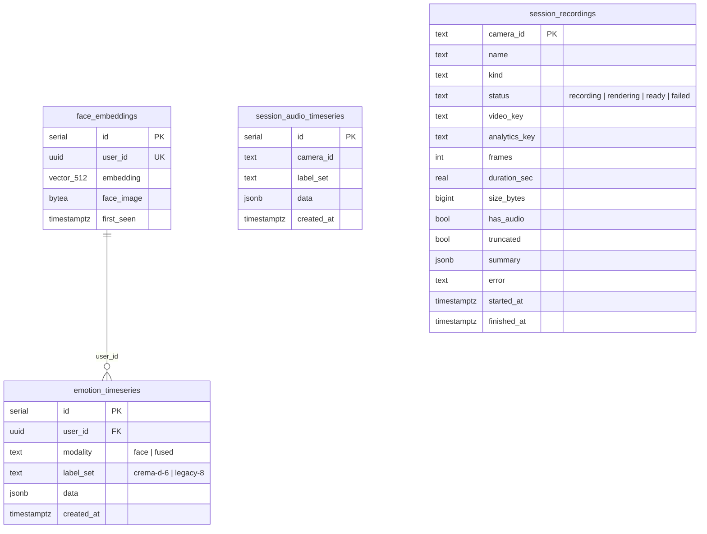

# `db_managing` — база данных

PostgreSQL 17 с расширением pgvector: люди и их эмбеддинги, таймсерии эмоций, голос сессий и статусы итоговых
записей. Модуль содержит схему, миграции и обёртки psycopg2 для сервисов обработки; веб-сервер работает с
БД через свой пул соединений (`web_server/services/db.py`).

```
src/db_managing/
├── schema.py             MIGRATIONS, ensure_schema, upsert_recording_sql, помощники по наборам классов
├── _abstract_handler.py  AbstractDBHandler: подключение и закрытие
└── _faces_db_handler.py  FacesDBHandler: лица, таймсерии, голос, записи
faces_emotions_database/  Dockerfile (postgres + pgvector) и init.sql для новой БД
```

---

## Таблицы



| Таблица | Пишет | Читает |
|---|---|---|
| `face_embeddings` | consumer (новый человек) | consumer (поиск), webapp (поиск по фото, снимок лица) |
| `emotion_timeseries` | consumer (`face`), fusion (`fused`) | webapp (история человека и сессии, CSV) |
| `session_audio_timeseries` | fusion | webapp (голос сессии) |
| `session_recordings` | webapp (имя и тип), archiver (статус и итоги) | webapp (раздел «Записи») |

Индексы: ivfflat по эмбеддингам (косинусное расстояние), по `user_id`, по `(user_id, modality)`, по
`data->>'camera_id'`, по `camera_id` голоса и по `started_at` записей.

## Миграции ([schema.py](../../src/db_managing/schema.py))

`ensure_schema(conn)` применяет все миграции из `MIGRATIONS` в одной транзакции. Миграции идемпотентны
(`IF NOT EXISTS`), поэтому их безопасно запускать при каждом подключении — так и делают `FacesDBHandler.connect`
и пул веб-сервера.

| Миграция | Что добавляет |
|---|---|
| `001_timeseries_modality` | колонки `modality`, `label_set` и индексы в `emotion_timeseries` |
| `002_session_audio_timeseries` | таблица голоса сессий |
| `003_session_recordings` | таблица итоговых записей |

`init.sql` создаёт таблицы новой БД при первом старте контейнера; всё, чего в нём нет (например,
`session_recordings`), добавляют миграции.

## `FacesDBHandler`

| Метод | Что делает |
|---|---|
| `connect()` | подключение и `ensure_schema` |
| `fetch(embedding, threshold)` | UUID ближайшего человека, если косинусное расстояние меньше порога |
| `insert(embedding, image)` | новый человек со снимком лица (JPEG) |
| `insert_emotion_timeseries(user_id, payload)` | таймсерия трека; `modality` из payload (`face` или `fused`) |
| `insert_session_audio(camera_id, payload)` | окна голоса сессии |
| `upsert_recording(camera_id, **fields)` | вставка или обновление записи только по переданным полям |

`upsert_recording_sql(fields)` строит `INSERT … ON CONFLICT (camera_id) DO UPDATE` только по разрешённым полям
(`RECORDING_FIELDS`); неизвестное поле — `ValueError`, поэтому имена колонок не попадают в SQL извне.

## Наборы классов

Записи старых моделей содержат 8 классов (`legacy-8`: с `contempt` и `surprise`), новые — 6 классов CREMA-D
(`crema-d-6`). Помощники `labels_for`, `label_set_of`, `scores_by_label` и `csv_label_columns` позволяют
читать и выгружать в CSV обе версии вместе: порядок `scores` берётся из поля `labels` записи или из
`LEGACY_LABELS`.

## Неочевидное

- Соединение psycopg2 не делится между потоками: идентификация и запись слитых таймсерий держат по одному
  фоновому потоку со своим соединением.
- Таймсерии пишутся при завершении трека, а не на каждом кадре: одна строка на появление человека в кадре.
- Удаление записи сессии (`DELETE /api/recordings/{id}`) удаляет объекты в S3 и строку `session_recordings`,
  но не таймсерии.
