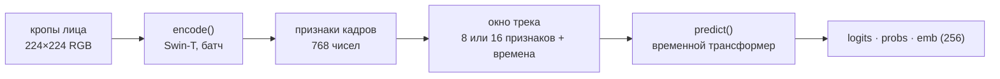

# `emotion_recognition` — эмоции по лицу

Оценить эмоцию человека по окну кадров его трека. Модель CREMA-D обучена на клипах 3 с, поэтому оценка
идёт не по одному кадру, а по 8 или 16 кадрам за последние 3 секунды.

```
src/frames_processing/processing/emotion_recognition/
├── clip_model.py          ClipEmotionModel, CremaClipModel, StubClipModel, load_clip_model
├── clip_window.py         ClipConfig, TrackClip, BoxStabilizer, crop_face, WindowSmoother, frame_times
├── emotion_recognizer.py  EmotionRecognizer — старые покадровые модели (8 классов), не используется пайплайном
└── pipeline_utils.py      стратегии сглаживания старых моделей
```

Классы — 6 эмоций CREMA-D из `src/emotion_labels.py`: `anger, disgust, fear, happy, neutral, sad`.

---

## Модель по окну



Контракт `ClipEmotionModel`:

| Метод | Вход | Выход |
|---|---|---|
| `encode(faces_rgb)` | `(N, 224, 224, 3)` uint8 | `(N, 768)` признаки кадров |
| `predict(feats, times)` | `(T, 768)` и времена кадров `(T,)` в секундах на шкале 0..3 | `{"logits", "probs", "emb"}` |

Кодирование и оценка окна разделены: кадр кодируется один раз, а окна идут с шагом 1 с и перекрываются.
Так каждый кадр кодируется ровно один раз, хотя попадает в три окна.

| Имя модели | Реализация | Точность |
|---|---|---|
| `crema-swin-int8` (по умолчанию) | `CremaClipModel`, энкодер int8 + голова | быстрее вдвое |
| `crema-swin` | `CremaClipModel`, fp32 | эталон, режим «Точнее» |
| `stub` | `StubClipModel` | случайная проекция для тестов и запуска без моделей |

`load_clip_model(model, device, num_threads)` — фабрика; инференс идёт через `emotion_kit.backends.VideoONNX`
на ONNX Runtime CPU. Неизвестное имя — ошибка, которую пайплайн превращает в откат на модель по умолчанию.

## Окна треков ([clip_window.py](../../src/frames_processing/processing/emotion_recognition/clip_window.py))

**`ClipConfig(n_frames=8, window_ms=3000, hop_ms=1000, min_coverage=0.6)`**

- кадр для окна берётся раз в `window_ms / n_frames` (375 мс при 8 кадрах);
- окно не считается, пока в нём меньше `ceil(0.6 × n_frames)` кадров — первая оценка появляется через
  2–3 с после появления лица.

**`TrackClip`** хранит признаки кадров трека по `pts`:

- `wants_frame(pts)` — нужен ли этот кадр по расписанию;
- `mark_sampled(pts)` — сдвинуть расписание сразу при отправке кропа в энкодер. Признак может прийти позже
  из фонового потока, а расписание уже не возьмёт лишний кадр;
- `add(pts, feat)` — положить признак; опоздавшие и выпавшие из окна отбрасываются;
- `window(pts)` — если пора, вернуть окно: равномерно выбранные `n_frames` признаков, времена
  `frame_times(n)`, границы окна и число реальных кадров.

Время назад больше чем на два окна (перемотка, новая сессия с тем же треком) сбрасывает трек.

**`frame_times(n)`** — времена кадров на шкале обучения (16 кадров за 3 с). Для 8 кадров берутся центры
8 сегментов из 16, как при обучении.

**`BoxStabilizer`** — скользящая медиана последних 7 рамок трека; при IoU с медианой ниже 0.5 история
сбрасывается (резкое движение). Дрожание рамки заметно портит качество модели.

**`crop_face(frame, box)`** — кроп как при обучении: запас 25 % с каждой стороны, resize в 224×224 без
сохранения пропорций, RGB.

**`WindowSmoother(keep=0.5, undetermined_below=0.4)`** — EMA вероятностей по окнам (примерно среднее по
2–3 окнам). Если максимум ниже 0.4, метка `None` — «не определено».

## Что уходит дальше

- В результат кадра — сглаженные `emotion` и `emotion_scores` и `window_seq`.
- На кадре нового окна — `emotion_window` с сырыми `logits`, `probs` и `emb`: их использует слияние
  (стекинг по эмбеддингам требует именно сырые выходы).
- В таймсерию трека — отсчёт `{t, label, scores}` для каждого окна с определённой эмоцией.

## Старые модели

`EmotionRecognizer` и `pipeline_utils.py` — прежние покадровые модели на 8 классов (ResNet, ConvNeXt,
EfficientNet, Swin) и их сглаживание. Пайплайн их больше не использует; код оставлен для экспериментов
и сравнения. Файлы этих моделей в Docker-образ не попадают.
