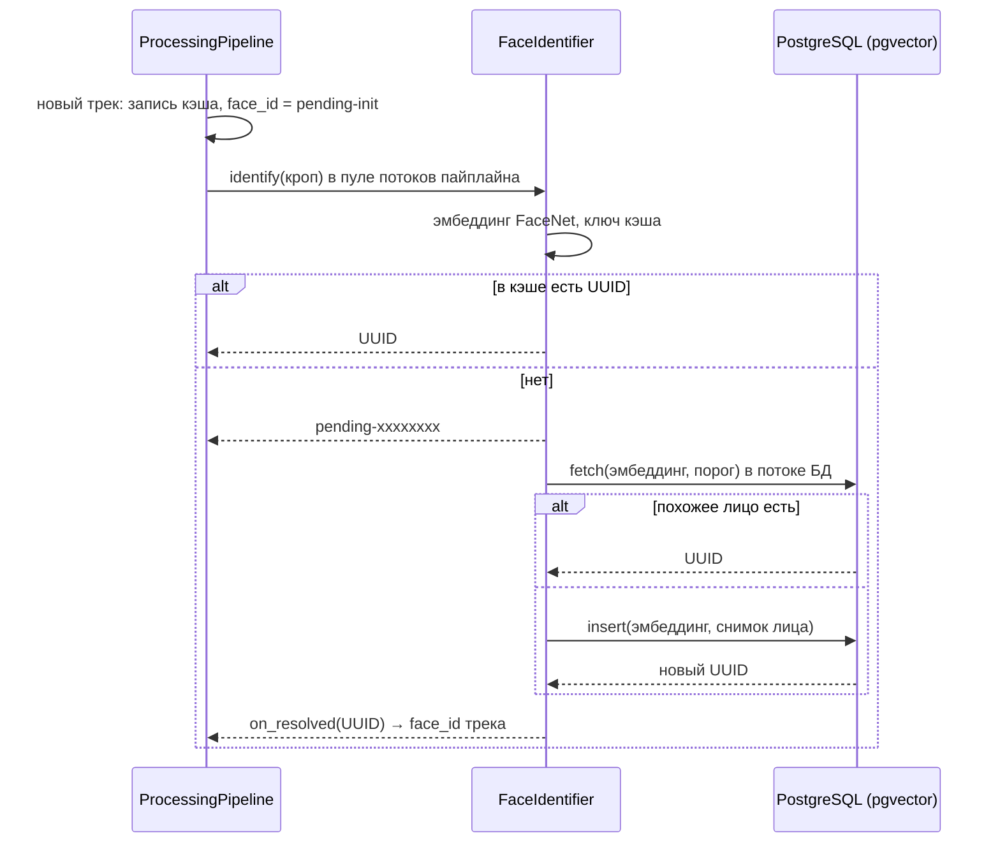

# `face_identification` — узнавание людей

Сопоставить лицо трека с человеком из базы: найти ближайший эмбеддинг в pgvector или завести нового
человека. По этому идентификатору копится история эмоций между сессиями.

```
src/frames_processing/processing/face_identification/
├── _face_encoder.py    FaceEncoder: эмбеддинг FaceNet (InceptionResnetV1, VGGFace2), 512 чисел
└── face_identifier.py  FaceIdentifier: кэш, фоновые запросы к БД, запись таймсерий
```

---

## Поток идентификации



- Пайплайн не ждёт БД: трек сразу получает временный `pending-…`, а настоящий UUID подставляется
  колбэком, когда фоновый запрос завершится.
- Все запросы к БД идут в одном потоке: соединение psycopg2 не делится между потоками.
- Поиск — по косинусному расстоянию (`<=>` в pgvector) с порогом `IDENTIFIER_THRESHOLD` (0.4). Если ближайшее
  лицо дальше порога, человек добавляется как новый.

## Кэш

Ключ — хэш эмбеддинга, округлённого до двух знаков (blake2b, 16 байт); время жизни — `cache_ttl` (30 с).
Кэш избавляет от повторных запросов, когда одно и то же лицо снова попадает в идентификацию, например
после потери трека. Просроченные записи чистятся раз в `cleanup_interval` вызовов.

## Таймсерии

`submit_emotion_timeseries(face_id, payload)` пишет таймсерию трека в `emotion_timeseries` в том же
потоке БД. Для `pending-…` запись пропускается: внешнему ключу нужен настоящий UUID.

## `FaceEncoder`

FaceNet из `facenet-pytorch` на CPU, torch ограничен одним потоком, чтобы не мешать модели эмоций. При
создании делается прогрев. В Docker веса скачиваются при сборке образа.

## Отключение

`IDENTIFICATION_ENABLED=false` или `identification = false` в настройках сессии: лица получают
`face_id = "anonymous"`, ни эмбеддинги, ни снимки не сохраняются, таймсерии лица в БД не пишутся.

## Поиск по фото

Веб-сервер (`services/face_search.py`) использует тот же `FaceEncoder` и детектор: находит самое крупное
лицо на фото, считает эмбеддинг и возвращает `top_k` ближайших людей со сводкой их истории.

## Неочевидное

- Эмбеддинг считается по кропу трека с первой свежей детекции, без выравнивания по ключевым точкам. При
  сильном повороте головы один человек может получить два UUID.
- Снимок лица (`face_image`) сохраняется только при первом появлении человека и показывается на странице
  «Люди».
