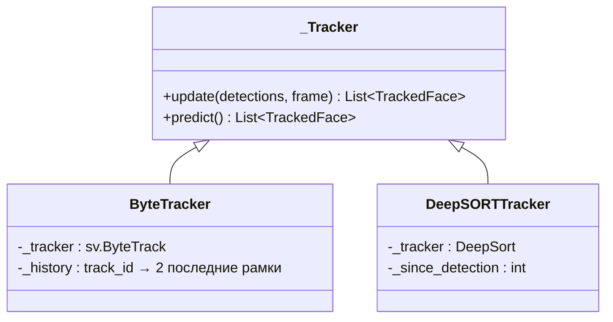

# `faces_tracking` — трекинг лиц

Связать детекции соседних кадров в треки: одно лицо получает стабильный `track_id`, и окна эмоций
и таймсерии копятся по человеку, а не по кадру.

```
src/frames_processing/processing/faces_tracking/
├── tracker.py         _Tracker, ByteTracker, DeepSORTTracker, get_tracker
├── tracked_face.py    TrackedFace: единый формат трека
└── tracking_utils.py  создание библиотечных трекеров, преобразование рамок
```

---

## Интерфейс

```python
class _Tracker:
    def update(self, detections, frame) -> List[TrackedFace]: ...   # кадр с детекцией
    def predict(self) -> List[TrackedFace]: ...                      # кадр без детекции
```

`get_tracker(settings)` выбирает реализацию по `settings["type"]` (`bytetrack`, `deepsort` и синонимы).
Пайплайн видит только `TrackedFace` и не зависит от алгоритма.



## `TrackedFace`

Лёгкий контейнер с рамкой в `xyxy`, как `to_ltrb()` у deep-sort-realtime.

| Поле / метод | Смысл |
|---|---|
| `track_id` | идентификатор трека внутри сессии |
| `hits` | сколько раз трек подтверждался детекцией |
| `time_since_update` | кадров с последней детекции; 0 — рамка с этого кадра |
| `is_confirmed()` | трек подтверждён |
| `to_ltrb()`, `to_xywh()` | рамка в нужном формате |

## `ByteTracker` (по умолчанию)

Обёртка `supervision.ByteTrack`: сопоставление по IoU с фильтром Калмана, без Re-ID признаков.

- **`predict()`.** supervision не умеет шаг без детекций, поэтому между детекциями рамка экстраполируется
  линейно по двум последним детекциям трека, не дальше 3 кадров.
- **Пустой кадр.** Кадр с детекцией, но без лиц, передаётся как `sv.Detections.empty()`, чтобы треки
  старели и завершались.
- **Частота детекции.** ByteTrack считает кадры по вызовам `update`, то есть по детекциям. При детекции раз
  в N кадров пайплайн делит его `frame_rate` на N и подтверждает трек за `ceil(K / N)` детекций. Без этой
  поправки при N = 3 совпадение эмоций с детекцией на каждом кадре падало до 53 %, с ней — 74 %. При N = 2
  оно 99 %, поэтому N = 2 выбрано по умолчанию.

## `DeepSORTTracker`

Обёртка `deep-sort-realtime` с Re-ID эмбеддером MobileNet. Устойчивее к пересечениям людей, но в несколько
раз медленнее. `predict()` делает шаг фильтра Калмана и возвращает треки, обновлявшиеся не раньше
последней детекции.

## Настройки (из `consumer.py`)

| Ключ | Значение | Для |
|---|---|---|
| `track_activation_threshold` | 0.25 | ByteTrack |
| `lost_track_buffer` | 30 | ByteTrack |
| `minimum_matching_threshold` | 0.8 | ByteTrack |
| `frame_rate` | 20 (делится на N) | ByteTrack |
| `minimum_consecutive_frames` | 3 (делится на N) | ByteTrack |
| `max_age`, `n_init`, `nn_budget`, `max_cosine_distance` | 30, 1, 100, 0.2 | DeepSORT |

## Неочевидное

- Трекер создаётся на каждую сессию, ключ — `(tracker, detection_frequency)`. Смена трекера в конфиге
  сессии пересоздаёт только трекер этой камеры.
- Пайплайн пропускает треки с `time_since_update >= detection_frequency`: рамка без детекции дольше
  интервала детекции уже ненадёжна.
