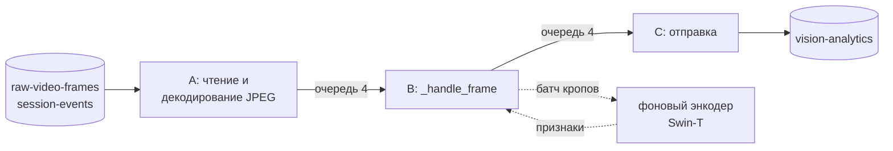

# `frames_processing` — видеопайплайн

Сервис `consumer.py`: из кадров `raw-video-frames` получает лица, треки, идентификаторы людей и эмоции
лица по окну кадров и пишет результат в `vision-analytics`.

```
src/frames_processing/
├── processing_pipline.py   ProcessingPipeline: стадии A/B/C, обработка кадра
├── session_control.py      SessionControl: настройки видео по сессиям
├── stream_metrics.py       StalenessFilter, LatencyWindow
├── kafka_io.py             KafkaIO: общий Kafka-ввод и вывод сервисов
└── processing/
    ├── face_detection/      → face_detection.md
    ├── faces_tracking/      → faces_tracking.md
    ├── face_identification/ → face_identification.md
    └── emotion_recognition/ → emotion_recognition.md
```

---

## Стадии A/B/C



- **A** (поток) — `consume`, отсев устаревших кадров (`StalenessFilter`, `MAX_FRAME_AGE_MS`), декодирование
  JPEG, события сессии.
- **B** (основной поток) — `_handle_frame` для кадра или `_handle_event` для события.
- **C** (поток) — сериализация JSON и отправка, замер задержки «захват → результат».

Короткие очереди (4 элемента) не дают задержке копиться: если обработка не успевает, старые кадры
отбрасываются ещё на стадии A.

## Обработка кадра (`_handle_frame`)

1. **Настройки сессии** — `SessionControl.settings(camera_id)`: секция `vision` конфига поверх значений по
   умолчанию. На первом кадре сессии ненадолго ждёт конфиг.
2. **Детекция** раз в `detection_frequency` кадров (по номеру кадра сессии), иначе `None`.
3. **Трекер сессии**: `update(detections)` или `predict()`. Трекер создаётся по ключу
   `(tracker, detection_frequency)`; настройки ByteTrack пересчитываются под частоту детекции
   (`_tracker_settings_for`).
4. Для каждого подтверждённого трека:
   - рамка обрезается по краям кадра; полоски уже `MIN_FACE_CROP_PX = 20` пропускаются;
   - на первой свежей детекции трека (не раньше 3 попаданий) `fast_face_filter` отсеивает «не лица»;
   - новый трек получает запись в кэше и идентификатор (`_update_identity`, запрос к БД в фоне);
   - на кадрах с детекцией рамка стабилизируется (`BoxStabilizer`), и если окну трека нужен кадр
     (`TrackClip.wants_frame`), кроп ставится в очередь на кодирование.
5. **Кодирование** (`_encode_faces`): кропы всех треков кадра — одним батчем в фоновый поток. Расписание
   окна сдвигается сразу (`mark_sampled`). Если в работе уже `max_encode_inflight` (2) батча, кропы
   пропускаются, и кадр для окна возьмётся позже.
6. **Окна эмоций** (`_update_track_emotion`): когда пора (шаг `emotion_hop_ms`), временная голова оценивает
   окно, результат сглаживается `WindowSmoother`. Отсчёт добавляется в таймсерию трека, а окно с логитами
   и эмбеддингом прикладывается к лицу как `emotion_window` — его использует слияние.
7. Раз в `cache_cleanup` кадров кэш треков чистится; таймсерии ушедших треков пишутся в БД
   (`_flush_emotion_timeseries`, `modality = face`).

Лицо в результате получает `predicted = true`, если рамка на этом кадре спрогнозирована трекером.

## `SessionControl` ([session_control.py](../../src/frames_processing/session_control.py))

- Проверяет значения: неизвестный трекер, `clip_frames` не из `(8, 16)`, шаг меньше 200 мс заменяются
  значениями по умолчанию с предупреждением.
- При смене трекера в конфиге помечает камеру на пересоздание трекера (`take_reset`).
- Ведёт номер кадра сессии для расписания детекции.

## События сессии

`stream_start` пишется в лог. На `stream_end` треки камеры закрываются и их таймсерии записываются сразу,
трекер и кэш освобождаются.

## `KafkaIO` ([kafka_io.py](../../src/frames_processing/kafka_io.py))

Консьюмер основного и дополнительных топиков (`extra_input_topics`) и продюсер результатов в JSON. Его же
используют аудиопайплайн и слияние. `close()` обязателен: иначе фоновые потоки librdkafka не дают процессу
завершиться.

## Метрики

Каждые 100 кадров в лог пишутся кадры в секунду, перцентили задержки, число отброшенных устаревших кадров
и пропущенных кропов энкодера.

`StalenessFilter` (он же отсеивает старые чанки звука и кадры аналитики в слиянии) не чаще раза в минуту
предупреждает о расхождении часов. Повод — кадр «из будущего» больше чем на 0,5 с или 100 устаревших кадров
подряд. Возраст кадра считается по часам двух разных машин, поэтому в распределённой установке нужен NTP
(см. [DEPLOYMENT.md](../DEPLOYMENT.md#5-время-на-узлах)).

## Неочевидное

- Ключ кэша треков — `(camera_id, track_id)`: id треков разных сессий пересекаются.
- Смена модели или параметров окна в конфиге перезапускает окна треков, накопленные признаки сбрасываются.
- Для сообщений schema 1 (без `pts_ms`) время кадра берётся из `timestamp`.
