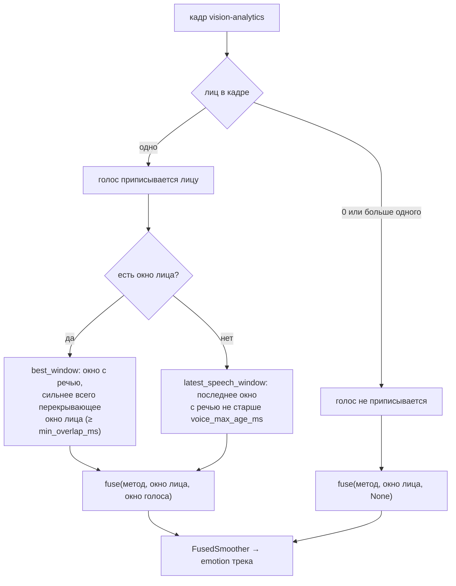

# `fusion` — слияние лица и голоса

Сервис `fusion_consumer.py`: объединяет оценки лица (`vision-analytics`) и голоса (`audio-analytics`) в
итоговую эмоцию каждого человека в кадре и пишет `fused-analytics`. Его результат видит пользователь:
интерфейс, серверная разметка и итоговая запись.

```
src/fusion/
├── service.py      FusionService: камеры, треки, подбор пар окон, публикация
├── fuse.py         ModalityFusion (обёртка emotion_kit), FusionParams, FusedSmoother
├── voice_state.py  VoiceState, VoiceEvidence: последние окна голоса камеры
└── recorder.py     FusionRecorder: слитые таймсерии и голос сессии в БД
```

---

## Подбор пары окон

Лицо оценивается окнами по 3 с раз в секунду (по треку), голос — окнами по 3 с раз в секунду (по камере).
Сливаются окна, а не кадры.



- **Новая пара — новое слияние.** Пара `(окно лица, окно голоса, метод)` сливается один раз; на остальных
  кадрах трек повторяет последний результат. Счётчик `fusion_seq` растёт только при новом слиянии.
- **Защита от мерцания.** Если окно лица уже слито с голосом, а в кадре на мгновение появилось второе лицо
  (голос перестаёт приписываться), прежняя пара сохраняется. Без этого ложная детекция заставляла трек
  перескакивать между «лицо + голос» и «только лицо».
- **Сглаживание.** `FusedSmoother` — EMA по окнам; ключ — окно лица (или окно голоса, если окна лица ещё
  нет), поэтому повтор того же окна не смещает среднее. Максимум ниже 0.4 — «не определено».

## Методы ([fuse.py](../../src/fusion/fuse.py))

`ModalityFusion` оборачивает `emotion_kit.fusion.Fusion` с параметрами из `models/crema/fusion_params.json`.

| Метод | Обучен | Что делает |
|---|---|---|
| `stack_hidden` (по умолчанию) | да | логистическая регрессия по эмбеддингам обеих моделей |
| `stack_logits` | да | то же по логитам |
| `weighted_logits`, `weighted_logits_robust` | да | взвешенная сумма логитов с подобранным α (robust — на зашумлённых данных) |
| `confidence_weighted` | нет | веса по уверенности модальностей |
| `mean_probs` | нет | среднее вероятностей |
| `video_only`, `audio_only` | нет | одна модальность |

Правила отката:

- нет файла параметров — обученные методы заменяются на `mean_probs`;
- у одной из моделей нет эмбеддинга — `stack_hidden` заменяется на `stack_logits`;
- одной модальности нет в окне — метод сам переходит на оставшуюся.

Фактически применённое попадает в `fusion_used`, например `stack_hidden -> video_only (нет аудио)`.
Интерфейс переводит его в «лицо + голос», «только лицо» или «только голос».

## Состояние голоса ([voice_state.py](../../src/fusion/voice_state.py))

`VoiceState` хранит последние окна `audio-analytics` камеры, отсортированные по концу окна.

- `best_window(start, end, min_overlap_ms)` — окно с речью и логитами, сильнее всего перекрывающее окно лица;
- `latest_speech_window(pts, max_age_ms)` — для лица, у которого окна ещё нет;
- `evidence_at(pts)` — голос сцены для кадра (`scene_voice`): последнее окно с речью, закончившееся не
  позже кадра (с допуском 200 мс), с возрастом `age_ms`.

## Параметры сессии

`FusionParams(method, voice_max_age_ms, min_overlap_ms)` — секция `fusion` конфига поверх значений по
умолчанию (`stack_hidden`, 3000, 1000). Неизвестный метод или неверные числа заменяются значениями по
умолчанию с предупреждением в логе.

## Запись в БД ([recorder.py](../../src/fusion/recorder.py))

`FusionRecorder` копит по трекам отсчёты слитой эмоции (новый отсчёт — только на новое слияние) и пишет
таймсерию в `emotion_timeseries` с `modality = fused`, когда трек пропал дольше `FUSION_TRACK_TIMEOUT_S`
или сессия закончилась. Окна голоса с речью копятся по камере и пишутся в `session_audio_timeseries`.
Запись идёт в фоновом потоке; таймсерии треков без UUID человека пропускаются.

## Жизненный цикл камеры

Камера появляется с первым сообщением и освобождается через `end_grace_s` после `stream_end` (чтобы дошли
запоздавшие окна) или после простоя. Пропавшие треки забываются через `track_timeout_s`. Каждые 100 кадров
в лог пишется задержка «захват → слияние», число слияний и лиц с приписанным голосом.
