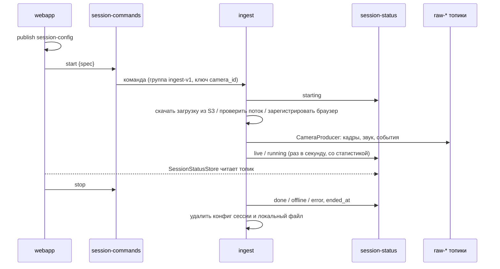
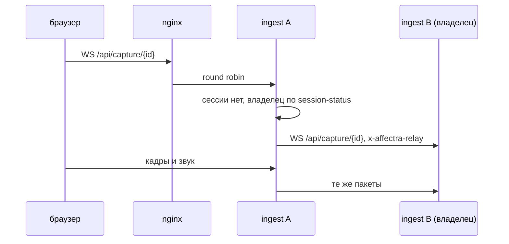

# `ingest` — сервис приёма медиа

Сервис `ingest.py`: запускает и останавливает продюсеры сессий по командам веб-сервера, публикует их статусы
и принимает камеру и микрофон браузера по WebSocket. Веб-сервер сам медиа не читает, поэтому приём можно
держать на отдельном узле — рядом с камерами или с хорошим каналом в Kafka.

```
src/ingest/
├── contracts.py     SessionSpec, SessionCommand, SessionStatus (msgpack)
├── service.py       IngestService: команды, подготовка источника, продюсеры, статусы
├── status_store.py  SessionStatusStore: копия session-status для веб-сервера и других узлов приёма
└── app.py           FastAPI: WS /api/capture/{id} с пересылкой владельцу, GET /health
ingest.py            точка входа (uvicorn, порт 8001)
```

---

## Взаимодействие с веб-сервером



- **Команды** (`session-commands`, хранение 1 ч) читаются группой `ingest-v1` со стратегией `range`: узлы
  приёма делят сессии по `camera_id`. Команды старше 60 с игнорируются, чтобы перезапущенный узел не поднял
  старые сессии.
- **Статусы** (`session-status`, compacted) — по одной записи на сессию. Веб-сервер держит копию топика
  (`SessionStatusStore`), поэтому список сессий переживает его перезапуск, а сами сессии продолжают идти.
- Если идущая сессия не обновляла статус дольше 10 с, веб-сервер показывает её как ошибку: узел приёма упал
  или недоступен. Завершённые и потерянные сессии удаляются из топика через час.

## Описание сессии (`SessionSpec`)

| Поле | Смысл |
|---|---|
| `camera_id`, `kind`, `name` | идентификатор, тип (`camera`, `upload`, `browser`), имя |
| `source` | адрес потока или номер камеры |
| `upload_id`, `upload_key`, `filename`, `file_size` | загрузка в объектном хранилище |
| `frame_rate`, `quality`, `max_width`, `max_height`, `modalities` | параметры продюсера |
| `config` | настройки из API — только для показа в интерфейсе |

## Подготовка источника

| Тип | Что делает узел | Ошибка |
|---|---|---|
| `upload` | скачивает объект из S3 в `INGEST_CACHE_DIR`, после сессии удаляет | нет хранилища или объекта |
| `camera` | `probe_source` и `check_modalities`: открывается ли поток и есть ли запрошенные дорожки | статус `error` с текстом |
| `browser` | регистрирует `BrowserSource`; медиа придёт по WebSocket | браузер не подключился за 30 с |

Подготовка идёт в пуле потоков (4), поэтому медленный поток или большой файл не задерживают другие команды.

## Статусы

`SessionStatus.state`: `starting` → `live` (поток, браузер) или `running` (файл) → `done` / `offline` / `error`.
В `stats` — статистика продюсера (кадры в секунду, прогресс, позиция, модальности, `degraded`, секунды звука),
в `error` — причина ошибки. Веб-сервер превращает статус в `SessionInfo` для API (`session_info`).

## Камера браузера

nginx направляет `/api/capture/` прямо в `ingest:8001`, минуя веб-сервер. Формат пакетов — `[uint8 тип][uint32 BE
pts_ms][данные]` (см. [video_producing.md](video_producing.md#источники)). Отключение браузера останавливает
сессию.

### Несколько узлов приёма

Источник браузера живёт на узле, который получил команду `start`, а nginx раздаёт WebSocket по всем узлам за
адресом `ingest`. Поэтому узел, к которому подключился браузер, сначала ищет сессию у себя, а если её нет —
в своей копии `session-status`. В статусе есть `ingest_id` и `ingest_address` владельца. Найдя владельца, узел
открывает WebSocket к `ws://<ingest_address>/api/capture/{id}` с заголовком `x-affectra-relay` и пересылает
туда все пакеты браузера. Отключение браузера закрывает пересылку, и владелец завершает сессию как обычно.
Подключение с этим заголовком дальше не пересылается, поэтому цикла между узлами быть не может.



Владельца узел ждёт до 3 с: статус мог ещё не дойти до его копии топика. Пересылка добавляет один переход
по внутренней сети, только если браузер попал не на тот узел. Два узла на одной машине поднимает
`docker-compose.multi-ingest.yml`. Узлы делят команды по партициям `session-commands`, поэтому партиций нужно
не меньше, чем узлов.

## Настройки

| Переменная | По умолчанию | Смысл |
|---|---|---|
| `KAFKA_BOOTSTRAP_SERVERS` | `localhost:9092` | Kafka |
| `TOPIC_SESSION_COMMANDS` / `TOPIC_SESSION_STATUS` | `session-commands` / `session-status` | топики управления |
| `TOPIC_SESSION_CONFIG`, `TOPIC_RAW`, `TOPIC_AUDIO_RAW`, `TOPIC_SESSION_EVENTS` | стандартные | конфиги и медиа |
| `INGEST_GROUP_ID` | `ingest-v1` | группа узлов приёма |
| `INGEST_CACHE_DIR` | `data/ingest_cache` | локальные копии загрузок |
| `INGEST_PORT` | `8001` | порт WebSocket и `/health` |
| `INGEST_ADVERTISED_ADDRESS` | IP контейнера и порт | `host:port`, по которому узел доступен другим узлам приёма |
| `S3_*` | — | хранилище загрузок |

## Остановка узла

При остановке узел останавливает все свои сессии, публикует их итоговые статусы и очищает кэш.
