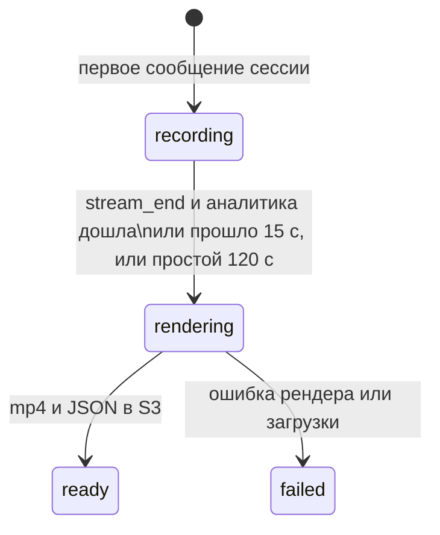

# `session_archive` — итоговая запись сессии

Сервис `archiver.py`: после окончания сессии собирает mp4 с рамками и подписями слитых эмоций и звуком,
а также JSON с таймлайном и сводкой, кладёт их в S3 и ведёт статус записи в БД.

```
src/session_archive/
├── service.py  ArchiveService: Kafka, спулы сессий, ожидание аналитики, фоновый рендер
├── spool.py    SessionSpool: кадры, звук и аналитика сессии на диске
├── render.py   render_recording (mp4), build_analytics_document (JSON)
├── series.py   build_series: секундный ряд субъекта (series.json) для агента-аналитика
└── storage.py  recording_keys; клиент S3 — общий src/object_storage.py
```

---

## Жизненный цикл записи



Статус пишется в `session_recordings` (`upsert_recording`). Имя и тип сессии туда же пишет веб-сервер при
её создании. Порядок записей не важен: каждая сторона обновляет только свои поля.

## Спул ([spool.py](../../src/session_archive/spool.py))

Во время сессии ничего не перекодируется, данные только дописываются в файлы каталога
`ARCHIVE_SPOOL_DIR/<camera_id>/`:

| Файл | Формат |
|---|---|
| `video.bin` | записи `[int64 pts_ms][uint32 длина][JPEG]` в порядке времени |
| `audio.pcm` | сплошной PCM s16le от первого чанка; разрывы больше чанка заполняются тишиной |
| `analytics.jsonl` | сокращённая слитая аналитика кадров (`compact_analytics`: рамки, эмоции, голос) |

Благодаря тишине на месте разрывов позиция в `audio.pcm` однозначно задаёт время. После
`ARCHIVE_MAX_DURATION_S` (30 минут) медиа больше не пишется, а запись помечается `truncated`.

## Когда начинать рендер (`ArchiveService.due`)

- после `stream_end`, когда слитая аналитика дошла до последнего кадра (`analytics_caught_up`) или прошло
  `ARCHIVE_ANALYTICS_GRACE_S` (15 с);
- без `stream_end`, если сессия молчит дольше `ARCHIVE_IDLE_TIMEOUT_S` (120 с) — на случай упавшего продюсера.

Запоздавшие сообщения уже завершённой сессии игнорируются ещё 10 минут, чтобы не завести новую запись.

## Рендер ([render.py](../../src/session_archive/render.py))

- **Видео** — H.264 (libx264, `crf 26`, `veryfast`, 2 потока) с переменной частотой кадров: у каждого кадра
  свой `pts`, поэтому пропуски и неровный темп сохраняются честно. Размер — первого кадра, округлённый до
  чётного.
- **Разметка** — для кадра берётся аналитика с тем же `pts` или последняя не старше 300 мс, рисуется общей
  функцией `draw_faces(..., details=True)`: рамка, итоговая эмоция и строка «face / voice».
- **Звук** — AAC 96 кбит/с; если звук начался позже видео, в начало добавляется тишина.
- **Контейнер** — mp4 с `+faststart`: браузер начинает показ, не дожидаясь конца файла.

Рендер идёт в одном фоновом потоке, сервис работает с пониженным приоритетом. Спул удаляется после рендера
в любом случае.

`build_analytics_document` собирает `analytics.json`:

```json
{
  "camera_id": "…", "label_set": "crema-d-6", "labels": ["anger", "…"], "session": {"…": "stream_start"},
  "truncated": false, "recording": {"frames": 554, "duration_sec": 27.7, "size_bytes": 2346797, "has_audio": true},
  "summary": {"frames_with_analytics": 554, "fused_label_counts": {}, "face_label_counts": {},
              "voice_label_counts": {}, "tracks": {"1": {"label_counts": {}, "dominant": "disgust"}}},
  "timeline": [{"pts_ms": 0, "t_ms": 0, "faces": [], "voice": null}]
}
```

`summary` сохраняется и в `session_recordings.summary` — интерфейс показывает распределения без загрузки
JSON.

### Секундный ряд (`series.json`)

Рядом с `analytics.json` архиватор пишет `series.json`: компактный ряд эмоций **субъекта** с шагом 1 с для
агента-аналитика ([emotion_moments.md](emotion_moments.md)). Час записи занимает сотни КБ, а не десятки МБ.

- **Субъект** («одна камера — один человек»).
  - Ключ человека — трек. Его личность — последний постоянный `face_id`; временные `pending-*` до узнавания не
    считаются.
  - Основа — человек с наибольшим числом кадров.
  - К нему добавляются люди, почти не пересекающиеся с ним по времени (вышел и вернулся с новым треком), кроме
    узнанных как другой человек.
- **По каждой секунде:**
  - средние вероятности субъекта — `fused`, `face`, `voice` (`null` — нет данных);
  - доли кадров: `face_present` (лицо субъекта), `predicted` (рамка от трекера), `others` (другие люди) и
    `speech` (речь).
  
  В `compact_analytics` для этого сохраняются `speaking` и `speech_prob` голоса. У старых записей вместо них
  берётся «голос оценён».
- **Старые записи.** Для записей, сделанных до появления `series.json`, его собирает
  `scripts/build_series.py` (`--force` — пересобрать все).

## Хранилище ([storage.py](../../src/session_archive/storage.py))

Клиент — общий `S3Storage` из `src/object_storage.py` (см. [common.md](common.md#srcobject_storagepy--объектное-хранилище)). Настройки — `S3_ENDPOINT`, `S3_ACCESS_KEY`, `S3_SECRET_KEY`,
`S3_BUCKET`, `S3_REGION`. Адресация path-style, подпись s3v4: так работает любое S3-совместимое хранилище.

Ключи — `recording_keys(camera_id)`: `sessions/<id>/recording.mp4`, `sessions/<id>/analytics.json` и
`sessions/<id>/series.json`.

**Ключи доступа.** SeaweedFS запускается скриптом `deploy/seaweedfs/s3-start.sh` с тремя ключами:
- `admin` — сервисы системы;
- `reader` — только чтение бакета записей, для MCP-сервера агента;
- `agent` — только свой бакет `affectra-agent-reports`, его скрипт создаёт при старте.

Тома SeaweedFS — по 1 ГБ, до 100 штук: у каждого бакета свои тома, и при настройках по умолчанию их не хватало
уже на второй бакет.

В docker-compose хранилище — SeaweedFS (`chrislusf/seaweedfs`, Apache 2.0) с S3 API на порту 8333: образы MinIO
с 2025 года не публикуются.

## Отдача пользователю

Веб-сервер (`routes/recordings.py`) читает список и статусы из БД, а видео отдаёт потоком из S3 с поддержкой
`Range` — в браузере работает перемотка. См. [web_server.md](web_server.md).
