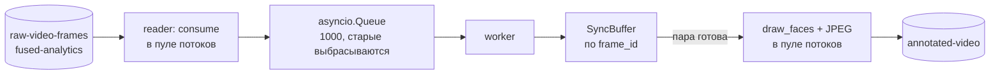

# `video_annotating` — разметка кадров

Нарисовать на кадре рамки лиц и подписи эмоций. Используется в двух местах:

- `visualizer.py` — фоновая серверная разметка потока в топик `annotated-video` (MJPEG `/api/stream/{id}`);
- `archiver.py` — разметка итогового видео сессии (`session_archive/render.py`).

В показе в реальном времени на сайте рамки рисует браузер (`frontend/src/components/live/`), сервер в этом
не участвует.

```
src/video_annotating/
├── video_annotator.py  draw_faces, VideoAnnotator
└── buffers.py          TTLBuffer, SyncBuffer: сопоставление кадров и аналитики по frame_id
```

---

## `draw_faces(frame, faces, details=False)`

Общая функция отрисовки по лицам из `vision-analytics` или `fused-analytics`:

- уверенная эмоция — цветная рамка и подпись `emotion: score`;
- оценка есть, но неуверенная — серая тонкая рамка и `undetermined`;
- оценки ещё нет — серая рамка без подписи;
- `details=True` (итоговая запись) — под рамкой строка `face: … voice: …` с оценками отдельных модальностей.

Подпись у рамки возле верхнего края кадра опускается, чтобы не обрезаться. Цвета эмоций — словарь `COLORS`
(BGR); подписи латиницей, потому что `cv2.putText` не рисует кириллицу.

## `VideoAnnotator`



- Чтение Kafka и обработка разнесены: reader складывает сообщения в очередь, worker сопоставляет кадр и
  аналитику по `frame_id` и рисует в пуле из 4 потоков.
- `SyncBuffer` хранит кадры 300 с и аналитику 60 с (`TTLBuffer`); пара выдаётся, как только есть обе
  половины, остальное чистится раз в 5 с.
- При переполнении очереди выбрасываются самые старые сообщения.
- Сервис работает с пониженным приоритетом и одним потоком OpenCV.

Источник аналитики задаётся `TOPIC_ANALYTICS`; в docker-compose это `fused-analytics`, поэтому подпись —
итоговая эмоция лица и голоса.
