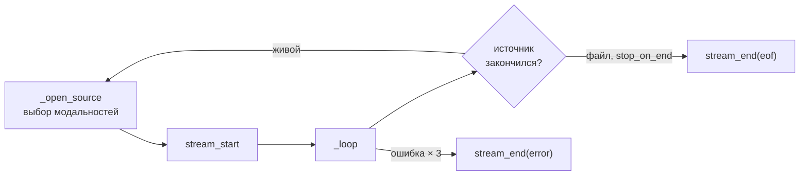

# `video_producing` — источники медиа и продюсер

Первая стадия: прочитать источник, привести кадры и звук к общему времени сессии и отправить их в Kafka
вместе с событиями начала и конца сессии.

```
src/video_producing/
├── config.py         CameraConfig: параметры продюсера
├── contracts.py      VideoMessage, AudioMessage, SessionEvent (msgpack, schema 2)
├── producer.py       CameraProducer: цикл чтения, темп, отправка, статистика
├── pacing.py         RealtimePacer, FrameDecimator, ReleaseOrderer
├── audio_chunker.py  AudioChunker: нарезка PCM на чанки фиксированной длины
├── probe.py          probe_source, check_modalities: открывается ли источник и какие в нём дорожки
└── sources/
    ├── base.py            VideoFrame, AudioChunk, SourceInfo, SessionClock, MediaSource
    ├── factory.py         open_source(config): выбор источника
    ├── file_source.py     FileSource: файл или сетевой поток через PyAV
    ├── live_source.py     LiveSource: вебкамера и микрофон на общих часах
    ├── webcam_source.py   WebcamSource: OpenCV (DirectShow на Windows)
    ├── mic_source.py      MicSource: sounddevice
    └── browser_source.py  BrowserSource: кадры и звук из WebSocket сервиса приёма
```

---

## Источники

Все источники реализуют `MediaSource`: `open(want_video, want_audio) -> SourceInfo`, генератор `read()`
с `VideoFrame` и `AudioChunk` в порядке захвата и `close()`.

| `config.source` | Источник | Особенности |
|---|---|---|
| путь к файлу | `FileSource` | видео и звук демультиплексируются в одном цикле, `pts` от общего нуля |
| `rtsp://`, `http://`, `udp://`… | `FileSource` | живой поток: таймаут открытия, `rtsp_transport=tcp` |
| номер камеры (`0`) | `LiveSource` → `WebcamSource` (+ `MicSource`) | общие часы `SessionClock` для кадров и звука |
| `mic` | `LiveSource` → `MicSource` | только звук |
| `browser:<id>` | `BrowserSource` из реестра | наполняется обработчиком WebSocket `/api/capture/{id}` сервиса приёма |

**`VideoFrame`** — кадр с ленивой загрузкой. `FileSource` передаёт `loader`, который переводит кадр в BGR и
уменьшает его до `max_size` прямо в декодере (`frame.reformat(..., interpolation="AREA")`). Это в разы
дешевле `cv2.resize`, и при прореживании 60 → 20 кадров/с две трети кадров вообще не конвертируются.

**`LiveSource`** читает камеру и микрофон в разных потоках и сливает их в одну очередь. При переполнении
выбрасываются кадры, но не звук: пропуск звука ломает окна аудиомодели. Обрыв одного источника обрывает
сессию целиком.

**`BrowserSource`**: сервис приёма вызывает `push_video(pts_ms, jpeg)` и `push_audio(pts_ms, pcm)`.
- Время берётся из браузера и привязывается к часам сервера по первому сообщению.
- JPEG декодируется лениво, только если продюсер кадр отправит.
- Звук режется `AudioChunker` на чанки по 100 мс.
- Если за `connect_timeout_s` (30 с) не пришло ни одного сообщения, `read()` бросает ошибку.
- Повторно открыть источник нельзя: сессия браузера одноразовая.
- Реестр `register` / `get` / `unregister` связывает продюсер и WebSocket одного процесса `ingest`.

## `CameraProducer` ([producer.py](../../src/video_producing/producer.py))



- **Модальности.** Продюсер отправляет пересечение запрошенного и того, что есть в источнике. Если нет ни
  одной запрошенной — `ModalityError` без переподключений. Если части нет — поток продолжается с флагом
  `degraded` (или ошибка при `strict_modalities`).
- **Темп.** Файл выпускается в реальном времени по `pts` (`RealtimePacer`); если чтение отстаёт, расписание
  сдвигается, а не догоняется. `ReleaseOrderer` упорядочивает видео и звук по времени выпуска.
- **Прореживание.** `FrameDecimator` оставляет кадры до `frame_rate` по `pts`, а не каждый k-й.
- **Отправка.** JPEG с качеством `quality`, кадр вписывается в `max_width × max_height` (в webapp —
  854 × 480). Медиа уходят с `acks=1` и коротким таймаутом доставки: свежесть важнее гарантий. События —
  с ожиданием подтверждения.
- **Партиции.** Ключ — `camera_id`, партиционер `murmur2_random`, как у продюсера конфигов: все потоки сессии
  попадают в партиции с одним номером.
- **Переподключение.** Живой источник переоткрывается после обрыва, время продолжается. После трёх
  неудач подряд продюсер останавливается.
- **Статистика.** `get_stats()` отдаёт текущие кадры в секунду, прогресс файла, позицию, модальности,
  `degraded` и секунды отправленного звука; сервис приёма публикует их в статусе сессии.

`CameraProducer` запускает сервис приёма ([ingest.md](ingest.md)); `producer.py` — его консольная версия для
отладки.

## Контракты ([contracts.py](../../src/video_producing/contracts.py))

`VideoMessage`, `AudioMessage` и `SessionEvent` — dataclass'ы с `to_msgpack` / `from_msgpack`. Неизвестные
поля при чтении игнорируются. Состав полей — в [`CODE_OVERVIEW.md`](../CODE_OVERVIEW.md#4-форматы-сообщений).

## `AudioChunker`

Режет PCM s16le на чанки фиксированной длины (по умолчанию 100 мс). Время чанка считается по счётчику
сэмплов от базы, поэтому дрейф не накапливается. Разрыв во входном времени больше длины чанка сбрасывает
базу.

## Неочевидное

- `CameraConfig.audio_chunk_ms * audio_sample_rate` должно делиться на 1000, иначе конфиг не создастся.
- Вебкамера на Windows открывается через DirectShow: MSMF на ноутбуках с Intel 11-го поколения часто не
  открывает камеру.
- В Docker нет доступа к вебкамере и микрофону хоста, поэтому живой захват там — только через браузер.
