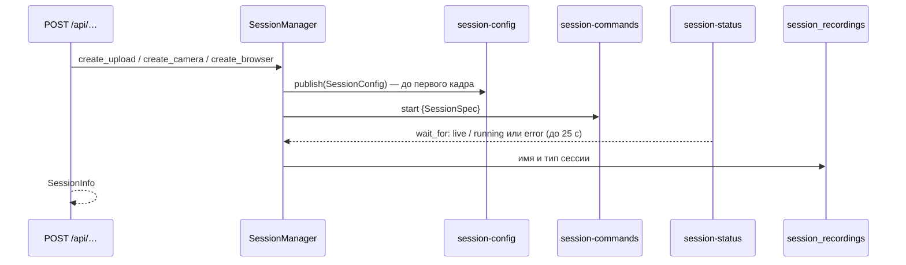

# `web_server` — веб-сервер

FastAPI-приложение (`webapp.py`): создаёт и останавливает сессии командами сервису приёма, принимает файлы в
объектное хранилище, раздаёт браузеру кадры и аналитику по WebSocket, отдаёт историю эмоций и итоговые
записи. Медиа веб-сервер не читает — это делает сервис приёма ([ingest.md](ingest.md)).

```
src/web_server/
├── main.py      приложение, жизненный цикл диспетчеров и пула БД, /api/health с готовностью сервисов
├── config.py    Settings из переменных AFFECTRA_*
├── schemas.py   pydantic-схемы API
├── routes/
│   ├── sessions.py    сессии: список, поток, браузер, остановка
│   ├── uploads.py     загрузки в S3, запуск их анализа, перенос старых локальных файлов
│   ├── streams.py     MJPEG /api/stream/{id} и WS /api/live/{id}
│   ├── events.py      WS /api/events/{id}: аналитика
│   ├── recordings.py  итоговые записи из S3
│   ├── storage.py     объём записей и загрузок, сроки автоочистки
│   └── history.py     люди, история, поиск по фото, CSV
└── services/
    ├── session_manager.py    конфиги, команды start/stop, список сессий по session-status
    ├── stream_dispatcher.py  кадры из Kafka подписчикам по camera_id
    ├── events_dispatcher.py  аналитика из Kafka подписчикам по camera_id
    ├── face_search.py        поиск человека по фото
    ├── recordings.py         клиент S3 (загрузки и записи), удаление записи целиком
    ├── retention.py          автоочистка старых записей и загрузок
    └── db.py                 пул соединений, миграции при старте
```

---

## Сессии (`SessionManager`)



| Метод | id сессии | Источник |
|---|---|---|
| `create_upload(name, upload_id, upload_key, …)` | `upload_xxxxxx` | объект `uploads/…` в S3, анализ до конца файла |
| `create_camera(name, source, frame_rate, config)` | `cam_xxxxxx` | `rtsp://…`, `http://…`, номер камеры, `mic` на узле приёма |
| `create_browser(name, frame_rate, config)` | `browser_xxxxxx` | медиа по `/api/capture/{id}` сервиса приёма |

- Перед стартом `check_ready` проверяет по `service-health`, что сервисы для модальностей сессии загрузили
  модели (см. [service_health.md](service_health.md)). Если нет — 400 с причиной, конфиг и команда не отправляются.
- Если узел приёма ответил ошибкой (поток не открылся, нет дорожек) или не ответил за 25 с, конфиг удаляется,
  а API возвращает 400 с причиной (`StartError`).
- Список сессий — копия compacted-топика `session-status` (`SessionStatusStore`). Перезапуск веб-сервера сессии
  не останавливает и из списка их не убирает. Завершённые сессии видны час, потом удаляются из топика.
- `session_info(status)` переводит статус узла приёма в `SessionInfo`: идущая сессия без обновлений дольше 10 с
  показывается как `error`; `starting` — как `running` у файла и `live` у потока.
- `DELETE /api/sessions/{id}` отправляет команду `stop`; сессия остаётся в списке с итоговым статусом.
- `running_upload_session(upload_id)` — какая сессия сейчас обрабатывает загрузку (для запрета удаления).
- `build_processing_config` переводит настройки API в `SessionConfig` по секциям.

## Раздача в браузер

| Канал | Откуда | Что |
|---|---|---|
| WS `/api/live/{id}` | `live_dispatcher` ← `raw-video-frames` | исходные кадры с заголовком `pts_ms`, очередь подписчика — 8 кадров |
| WS `/api/events/{id}` | `events_dispatcher` ← `fused-analytics` | аналитика, раз в 15 с ping |
| `GET /api/stream/{id}` | `stream_dispatcher` ← `annotated-video` | MJPEG серверной разметки |

Диспетчеры читают Kafka в своём потоке и раскладывают сообщения по очередям подписчиков в event loop.
Кадры камер, на которые никто не подписан, не декодируются. Медленный подписчик теряет старые кадры, но не
тормозит остальных.

## Загрузки (`routes/uploads.py`)

- `POST /api/uploads` — файл (до 2 ГБ) пишется во временный каталог, проверяется (`probe_source`) и уходит в S3
  как `uploads/<id>.<ext>` с метаданными: исходное имя, дорожки, длительность. Файл без видео и звука — 415.
- `GET /api/uploads` — список объектов `uploads/` с метаданными (кэшируется в памяти).
- `POST /api/uploads/session` — запуск анализа: узел приёма скачает объект себе.
- `DELETE /api/uploads/{id}` — 409, если файл сейчас обрабатывается.
- При старте веб-сервер один раз переносит в S3 файлы, загруженные до перехода на хранилище
  (`migrate_local_uploads`), вместе с исходными именами.

## Записи (`routes/recordings.py`)

- `GET /api/recordings` и `/{id}` — список и статус из `session_recordings`.
- `GET /api/recordings/{id}/video` — mp4 из S3 потоком; заголовок `Range` передаётся в S3, ответ 206 с
  `Content-Range` — в браузере работает перемотка. `?download=true` — скачивание.
- `GET /api/recordings/{id}/analytics` — JSON записи.
- `DELETE /api/recordings/{id}` — удаляет объекты в S3 и строку; для незавершённой записи 409.

## Хранение и автоочистка (`routes/storage.py`, `services/retention.py`)

- `GET /api/storage` — число и объём записей (по `session_recordings`) и загрузок (по S3), сроки хранения.
- `RetentionService` — фоновый поток веб-сервера, работает при ненулевом сроке. Первая проверка идёт через
  минуту после старта, дальше раз в час:
  - удаляются записи в статусе `ready` или `failed`, законченные раньше `AFFECTRA_RECORDINGS_RETENTION_DAYS`
    дней назад (`delete_recording_data`, тот же путь, что у `DELETE`);
  - удаляются загрузки старше `AFFECTRA_UPLOADS_RETENTION_DAYS` дней, кроме файлов, которые сейчас
    обрабатываются (`delete_uploads_older_than`).

  Ошибка с одной записью не останавливает остальные.

## История (`routes/history.py`)

Люди и их снимки, история эмоций человека и сессии по модальности (`face` или `fused`), голос сессии, поиск
похожих лиц по фото (`top_k`), выгрузка CSV. Записи старых моделей (8 классов) читаются вместе с новыми.

## Настройки (`config.py`)

`AFFECTRA_KAFKA`, `AFFECTRA_TOPIC_*` (в том числе `SESSION_COMMANDS`, `SESSION_STATUS` и `SERVICE_HEALTH`),
`AFFECTRA_REQUIRE_READY` (проверка готовности сервисов перед стартом, по умолчанию включена),
`AFFECTRA_RECORDINGS_RETENTION_DAYS` и `AFFECTRA_UPLOADS_RETENTION_DAYS` (0 — хранить всегда), `AFFECTRA_DB_*`,
временный каталог загрузок `data/uploads`, параметры продюсера для новых сессий (854 × 480, качество JPEG 60),
предел загрузки 2048 МБ, CORS для dev-сервера. Клиент S3 читает `S3_*`.

## Неочевидное

- Веб-сервер не хранит состояние сессий у себя: всё в Kafka, PostgreSQL и S3. Это шаг к нескольким экземплярам
  веб-сервера за балансировщиком.
- При старте приложение приводит схему БД к текущей версии, поэтому первый запуск после обновления может
  занять на секунду дольше.
- Полная спецификация API — Swagger на `/docs`.
